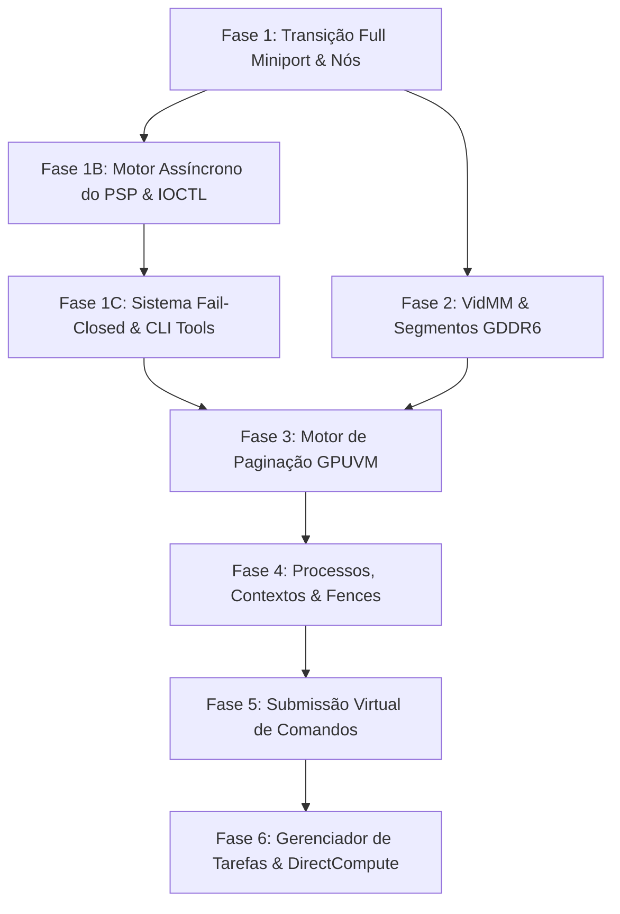

# Roadmap de Implementação: Full WDDM 2.0+ (Silício Puro)
**Projeto:** Driver Nativo AMD BC-250 (Cyan Skillfish / Navi12 Lite / Oberon APU)  
**Escopo:** Kernel-Mode Display + Render Miniport (Sem Vulkan, Sem OpenGL/Mesa, Sem Runtimes Externos)  
**Versão Base:** BC250-V3  

---

## 1. Visão Geral e Arquitetura do Sistema

O objetivo deste roadmap é guiar a transição da base sólida de silício do **BC250-V3** (KMDOD + D3DKMT Escapes) para um driver **Full WDDM 2.0+ nativo do Windows**. Isso permitirá que o sistema operacional reconheça a AMD BC-250 como uma **GPU 3D e GPGPU dedicada de 16 GB**, integrando-se diretamente ao **Gerenciador de Tarefas do Windows**, ao **VidMM (Video Memory Manager de 64 bits)** e ao subsistema **DirectCompute / D3D12 Core**, controlando o silício diretamente via Ring 0.

```
                           ARQUITETURA ALVO: FULL WDDM 2.0+ SILÍCIO PURO
                           
       ┌─────────────────────────────────────────────────────────────────────────────┐
       │                SUBSISTEMA GRÁFICO WINDOWS (DWM / DIRECTX / GPGPU)           │
       │    • Gerenciador de Tarefas: Gráficos 3D, Compute 0, Copy e 16 GB VRAM      │
       │    • VidMM: Alocação de Páginas de 64-bit e Agendamento de GPU              │
       │    • Suporte Nativo a DirectCompute (1536 Shaders / 12 WGPs) sem ICDs       │
       └──────────────────────────────────────┬──────────────────────────────────────┘
                                              │
       ┌──────────────────────────────────────┴──────────────────────────────────────┐
       │                 KERNEL-MODE DRIVER WDDM 2.0+ (DxgkInitialize)               │
       │                                                                             │
       │  [ VidMM & Segmentos ]                  [ Motor de Paginação GPUVM ]        │
       │  • Segmento 0: 16 GB GDDR6 Física       • SDMA0 Hardware Blit & Memory Fill │
       │  • Segmento 1: Aperture GART Host       • RDNA1 GCVM Page Table Updater     │
       │                                                                             │
       │  [ Contextos & Monitored Fences ]       [ Submissão Virtual (64-bit) ]      │
       │  • DxgkDdiCreateProcess / Context       • DxgkDdiSubmitCommandVirtual       │
       │  • Fences de Hardware de 64 bits        • CP PM4 GFX Ring & Compute Queues  │
       │                                                                             │
       │  [ Motor Assíncrono do PSP ]            [ Segurança Fail-Closed & SMN ]     │
       │  • Anel GPCOM 0x58000 (Frames 64-byte)  • Parâmetros de Registro Granulares │
       │  • Atestação Criptográfica (0x0F)       • Ferramentas CLI SMN, PSP & Zen2   │
       │  • Carga Dinâmica de FW (0x80000C20)    • Dashboard & Ring Monitor em Tempo │
       └──────────────────────────────────────┬──────────────────────────────────────┘
                                              │
       ┌──────────────────────────────────────┴──────────────────────────────────────┐
       │                     HARDWARE REAL AMD BC-250 (CYAN SKILLFISH)               │
       │   SMU 1500 MHz  │  PSP 7 Microcódigos  │  1536 Shaders  │  SDMA0  │ CP Ring │
       └─────────────────────────────────────────────────────────────────────────────┘
```

---

## 2. Fases de Execução

---

### 📍 FASE 1: Transição para Full Miniport & Topologia de Nós de Hardware
> **Objetivo:** Migrar o ponto de entrada do driver para `DxgkInitialize` e expor a topologia física de motores da Navi12 Lite ao escalonador do Windows.

- [ ] **Migração do Ponto de Entrada do Driver**:
  - Trocar `DxgkInitializeDisplayOnlyDriver` por `DxgkInitialize` em `DriverEntry`.
  - Configurar a estrutura completa `DRIVER_INITIALIZATION_DATA` com todos os ponteiros DDI de Render + Display.
- [ ] **Topologia dos Motores de Execução (Engine Topology)**:
  - Declarar 3 nós de execução assíncronos ao Windows:
    - **Nó 0 (`DXGK_ENGINE_TYPE_3D`)**: Fila principal do Command Processor (Ring 0 / 3D Graphics).
    - **Nó 1 (`DXGK_ENGINE_TYPE_COMPUTE`)**: Fila assíncrona de computação GPGPU (MEC1 / MEC2).
    - **Nó 2 (`DXGK_ENGINE_TYPE_COPY`)**: Fila física da engine SDMA0 (Direct Memory Access).
- [ ] **Capacidades do Adaptador Físico (`DXGKQAITYPE_PHYSICALADAPTERCAPS`)**:
  - Configurar `NumExecutionNodes = 3`.
  - Configurar `PagingNodeIndex = 2` (designar o motor SDMA0 como nó exclusivo de paginação de alta velocidade).
  - Configurar `Flags.MonitoredFenceSupported = 1` e `Flags.MapCpuHostApertureSupported = 1`.

---

### 📍 FASE 1B: Motor Assíncrono do PSP & Gestão Dinâmica de Microcódigos 🔄
> **Objetivo:** Evoluir a comunicação com o Platform Security Processor (PSP) de mailbox síncrono para o anel de fila GPCOM em memória com suporte a comandos avançados e carga dinâmica de firmware.

- [ ] **Anel de Fila GPCOM em Memória (`MMIO 0x58000`)**:
  - Alocar anel contíguo em Host RAM (`MmAllocateContiguousMemorySpecifyCache`) para frames GPCOM de 64 bytes (`psp_gfx_rb_frame`).
  - Implementar ponteiros de anel por hardware: `PSP_GFX_RB_WPTR` e `PSP_GFX_RB_RPTR`.
  - Polling assíncrono de fences de conclusão com invalidação de cache `HDP_MEM_COHERENCY_FLUSH`.
- [ ] **Comandos Avançados de Segurança e Integridade**:
  - Implementar comando de Atestação Criptográfica (`GFX_CMD_ID_GET_FW_ATTESTATION = 0x0F`) para validação em tempo de execução da integridade dos microcódigos assinados.
  - Implementar derivação de chaves de hardware seguras e validação de inicialização do co-processador TrustZone.
- [ ] **Carga Dinâmica de Firmwares via Disco / IOCTL (`0x80000C20`)**:
  - Implementar handler de IOCTL para carregar arquivos de microcódigo binários (`.bin`) diretamente do sistema de arquivos para a VRAM/TMR.
  - Suporte a atualização ou recarregamento de microcódigos (`SDMA0`, `RLC_G`, `CP_CE`, `CP_PFP`, `CP_ME`, `CP_MEC`) sem necessidade de reinicialização do sistema.

---

### 📍 FASE 1C: Sistema Fail-Closed (Zero-BSOD), Ferramentas CLI & Dashboard em Tempo Real 🛡️
> **Objetivo:** Estabelecer controle granular e segurança absoluta na inicialização do silício via registro, criar utilitários CLI de baixo nível (SMN/PSP/Zen2) e disponibilizar um Dashboard de monitoramento em tempo real.

- [ ] **🛡️ Sistema de Chaves de Registro "Fail-Closed" (`HKLM\...\Services\bc250v3\Parameters`)**:
  - `HwInitMaxStep`: Limita a inicialização ao passo $N$ (permite isolar falhas de hardware por busca binária sem recompilar o driver).
  - `HwUnhaltCp`: Permite manter o CP congelado para isolar acessos de memória e depurar anéis sem execução ativa.
  - `DisplayWritesEnabled`: Protege o scanout do display do UEFI GOP contra telas pretas acidentais e escritas fora dos limites.
  - `HwInitFirmware`, `HwInitGfxRing`, `HwInitSdmaRing`, `HwInitGart`: Toggles booleanos individuais para ligar/desligar cada bloco de silício de forma isolada.
- [ ] **🧰 Suíte de Ferramentas de Baixo Nível (CLI)**:
  - `bc250-smn-tool.exe`: Leitura/escrita direta no barramento SMN (*System Management Network*), controle dinâmico de P-States (500 MHz até 2000 MHz / curva de voltagem), monitor de temperaturas e disparo da mensagem SMU `0x98` para desbloquear os 8 núcleos (16 threads) da CPU Zen2.
  - `bc250-psp-tool.exe`: Injeção de opcodes brutos do PSP (`0x05`, `0x06`, `0x0F`, `0x20`, `0x21`) e validação de assinaturas criptográficas de microcódigo.
- [ ] **🖥️ Dashboard em Tempo Real (BC250 Control Center / Studio CLI + GUI)**:
  - **Live Ring Engine Monitor**: Monitoramento em tempo real (em microssegundos) dos ponteiros `WPTR`, `RPTR` e ocupação percentual dos anéis CP Ring 0, SDMA0 e PSP.
  - **GPU Memory Map Visualizer**: Mapa visual da alocação dos 16 GB GDDR6 UMA (GOP Scanout, Staging Compute, GART Aperture, TMR Carveout e buffers de paginação).
  - **Live Event Stream & Filtro**: Registro em tempo real de chamadas de escape D3DKMT, commits de memória e submissões de Indirect Buffers (IBs).

---

### 📍 FASE 2: VidMM & Segmentos de Memória Física (16 GB GDDR6)
> **Objetivo:** Integrar o Video Memory Manager (VidMM) do Windows diretamente à memória GDDR6 e à abertura GART de sistema.

- [ ] **Declaração de Segmentos de Memória (`DXGKQAITYPE_QUERYSEGMENT4`)**:
  - **Segmento 1 (Local Dedicated VRAM)**:
    - Base física: `BAR0` (`0xF400000000`).
    - Tamanho: 16.384 MB (16 GB GDDR6).
    - Flags: `DirectFlip = 1`, `CpuVisible = 1`, `HardwareReserved = 256 MB` (carveout PSP TMR e anéis).
  - **Segmento 2 (Host Aperture / GART)**:
    - Espaço de memória do sistema mapeável via barramento PCIe para transferências DMA.
- [ ] **Propriedades e Métricas de Memória**:
  - Relatar a largura de banda teórica e medida da GDDR6 para que o VidMM tome decisões otimizadas de posicionamento de alocações.

---

### 📍 FASE 3: Motor de Paginação GPUVM & Tabelas de Páginas RDNA1
> **Objetivo:** Construir o tradutor de endereços virtuais de GPU (GPUVM de 64 bits) e o motor de preenchimento/transferência via SDMA0.

- [ ] **Estrutura de Tabelas de Páginas da GCVM (Navi12 Lite)**:
  - Implementar o esquema de 4 níveis de paginação RDNA1:
    - `PDB` (Page Directory Base) -> `PDE2` -> `PDE1` -> `PTE` (Page Table Entries de 64 bits).
    - Bits de controle: `VALID`, `SYSTEM`, `READABLE`, `WRITEABLE`, `COHERENT`, `CACHE_POLICY`.
- [ ] **Motor de Paginação (`DxgkDdiBuildPagingBuffer`)**:
  - **`DXGK_OPERATION_UPDATE_PAGE_TABLE`**: Atualização atômica das entradas PTE da GCVM utilizando pacotes de escrita da engine SDMA0.
  - **`DXGK_OPERATION_TRANSFER`**: Transferência ultrarrápida de blocos de memória entre Host RAM e GDDR6 utilizando DMA físico.
  - **`DXGK_OPERATION_FILL`**: Preenchimento acelerado por hardware de regiões de memória com valores constantes.
  - **`DXGK_OPERATION_FLUSH_TLB`**: Invalidação dos caches de TLB da GCVM (`A_VM_INVALIDATE_ENG`) e esvaziamento do Host Data Path (`HDP`).

---

### 📍 FASE 4: Processos, Contextos e Monitored Fences de 64 bits
> **Objetivo:** Fornecer isolamento de memória por processo e sincronização atômica de 64 bits entre CPU e GPU.

- [ ] **Gestão de Espaço de Endereçamento por Processo**:
  - **`DxgkDdiCreateProcess`**: Alocar e inicializar a raiz da tabela de páginas GPUVM (`PageTableBaseAddress`) para cada processo do Windows.
  - **`DxgkDdiDestroyProcess`**: Liberar as estruturas de tabelas de páginas do processo.
- [ ] **Gestão de Contextos de Hardware**:
  - **`DxgkDdiCreateContext`**: Criar contexto de execução com estruturas de estado do Command Processor.
  - **`DxgkDdiDestroyContext`**: Destruir contexto e desalocar recursos.
- [ ] **Monitored Fences Nativas (64-bit Fences)**:
  - Implementar `DxgkDdiCreateHwContext` e suporte a objetos de fence monitorada em memória compartilhada.
  - Interrupção de hardware via `DxgkCbNotifyInterrupt` com evento `DXGK_INTERRUPT_DMA_COMPLETED` disparado por pacotes `PACKET3_FENCE_EVENT`.

---

### 📍 FASE 5: Agendador e Submissão Virtual de Comandos
> **Objetivo:** Conectar o escalonador de GPU do Windows diretamente aos anéis CP PM4 e filas de computação da BC-250.

- [ ] **Submissão Virtual de Comandos (`DxgkDdiSubmitCommandVirtual`)**:
  - Receber buffers de comandos com endereçamento virtual de 64 bits (`D3DGPU_VIRTUAL_ADDRESS`).
  - Montar pacotes de despacho PM4 nos anéis sem necessidade de patch de ponteiros físicos.
- [ ] **Mecanismo de Preempção e Timeout Recovery (TDR)**:
  - **`DxgkDdiQueryEngineStatus`**: Consultar estado de execução do nó em tempo real (`GRBM_STATUS`).
  - **`DxgkDdiResetEngine`**: Recuperação suave em caso de travamento de shader, limpando a fila do nó e restabelecendo os anéis sem reiniciar o computador.

---

### 📍 FASE 6: Validação no Windows, Gerenciador de Tarefas e DirectCompute
> **Objetivo:** Confirmação de que a GPU é totalmente reconhecida pelo sistema operacional, com suporte a monitoramento visual e computação de alto desempenho.

- [ ] **Gerenciador de Tarefas do Windows (Task Manager)**:
  - Exibição da placa na aba **Desempenho -> GPU**:
    - Gráfico de utilização **3D Engine**.
    - Gráfico de utilização **Compute 0**.
    - Gráfico de utilização **Copy (SDMA0)**.
    - Gráfico de **Memória de Vídeo Dedicada (16,0 GB GDDR6)**.
    - Exibição de temperatura e clock em tempo real integrados com o SMU.
- [ ] **DxDiag & Sistema Operacional**:
  - Relatório de Driver Model: **WDDM 2.0 (ou superior)**.
  - Memória Total Aproximada: **16.384 MB**.
- [ ] **DirectCompute & DirectML Nativo**:
  - Execução de workloads de IA, inferência de LLMs e shaders computacionais utilizando a API nativa DirectCompute do Windows diretamente nos 1536 Stream Processors.

---

## 3. Cronograma e Matriz de Dependências



---

## 4. Resumo das DDIs e Interfaces de Kernel

| Componente / DDI | Tipo | Finalidade |
| :--- | :--- | :--- |
| `DxgkInitialize` | Entry Point | Inicialização do Miniport Full WDDM 2.0+ |
| `DxgkDdiQueryAdapterInfo` | DDI | Exposição de caps WDDM 2.0, nós de execução e segmentos |
| `DxgkDdiBuildPagingBuffer` | DDI | Operações de GPUVM (Atualização de PTEs, Flush TLB, Cópias SDMA) |
| `DxgkDdiCreateProcess` | DDI | Criação do espaço de endereçamento virtual de 64 bits por processo |
| `DxgkDdiCreateContext` | DDI | Criação do contexto de execução de 3D/Compute |
| `DxgkDdiSubmitCommandVirtual` | DDI | Submissão de comandos virtuais de 64 bits para os anéis de silício |
| `DxgkDdiResetEngine` | DDI | Recuperação automática de falhas e TDR no hardware |
| `MMIO 0x58000` (GPCOM) | Hardware Ring | Anel assíncrono de segurança do PSP (Frames 64-byte) |
| `IOCTL 0x80000C20` | Kernel Bridge | Carga dinâmica de microcódigo do disco para a GPU |
| `bc250-smn-tool.exe` | CLI Tool | Barramento SMN, P-States, Curva de Tensão e Uncap da CPU Zen2 (SMU 0x98) |
| `bc250-psp-tool.exe` | CLI Tool | Injeção de opcodes brutos PSP e atestação de segurança |
