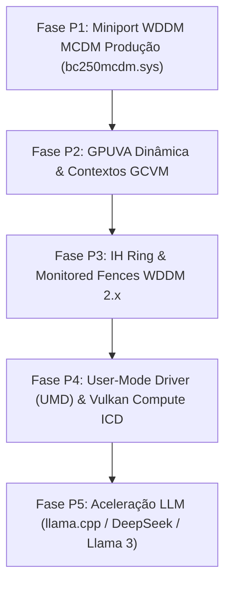

# BC-250 Windows Driver — Status Consolidado e Roadmap

> **Revisão 5.0 — 2026-08-30 (Tarde).** Estado vigente após o candidato físico
> **3.43 / Schema 114**: **SHADER & COMPUTE F8b VALIDADO EM HARDWARE!**
> O tripé físico de computação (RPTR==WPTR==45 estrito, drenagem de 100% do ring
> com PQ_EMPTY=1, QUEUE_IDLE=1, fence física em VRAM 0xBC250D15 gravada pela GPU,
> 0 mismatches de dados e rollback transacional com RestoreFailureCount=0) foi
> **100% aprovado no silício real da APU AMD BC-250 com o display ativo**.
> Registro físico canônico: [`docs/127_RESULTADO_FISICO_3.43.md`](docs/127_RESULTADO_FISICO_3.43.md).
> Handoff vigente: [`docs/128_HANDOFF_IA_APOS_CANDIDATO_3.43.md`](docs/128_HANDOFF_IA_APOS_CANDIDATO_3.43.md).

> **Revisão 4.0 — 2026-08-29 (noite).** Consolida: validação física do CP PM4, do compute
> MEC/HQD e do caminho de display WDDM, comparação com o projeto de referência
> `AMD-BC-250-Windows-Driver` e o roadmap de fases. Os percentuais estão separados em dois
> eixos (implementado × provado), a partir de auditoria do corpus em `docs/evidence/` cruzada
> com o código-fonte.
>
> **Mudanças desta revisão**: (1) o **CP Ring 0 fechou o tripé estrito** — `RPTR==WPTR`,
> fence física com veneno verificado e dados conferidos byte a byte — em **59/59** dos ciclos
> em que rodou (seção 2.0.4); (2) o **compute MEC/HQD** fecha o gate estrito no mesmo ciclo,
> também 59/59; (3) a **intermitência do PFP foi RESOLVIDA** e era regressão de código nossa,
> não silício (seção 2, histórico); (4) o **gate do CP foi corrigido**, não homologado
> (seção 4); (5) o roadmap ganhou o **caminho em fases até computação real** (seção 8.1).
>
> **Números conflitantes em revisões anteriores** (3/3, 26x, 39/39) são etapas intermediárias
> do mesmo dia. O valor vigente é **59/59**, do soak de 60 ciclos — o único ciclo que não
> fechou foi bloqueado pelo SDMA antes de o CP rodar.
>
> Não substitui os documentos detalhados em `docs/` — é o ponto de entrada rápido para retomar.

> **Atualização de 30/08/2026 — candidato 3.28 / Schema 99 (offline):** a
> terceira tentativa física (3.27) chegou a `RPTR==WPTR==40`, mas resultado e
> fence permaneceram envenenados; portanto, **não houve prova de shader**. A
> análise encontrou `CP_HQD_PQ_BASE` programado com endereço físico apesar de o
> Contexto 0 mapear a fila por GPUVA baixa. O 3.28 passa a publicar GPUVA
> `0x10000`, prova `PTE[0x10] -> ring físico`, relê os 64 dwords do ring e falha
> antes de `APPLY` em qualquer divergência. Build, testes, assinatura e auditoria
> passaram; pacote não instalado. Registro completo em
> [`docs/101_REGISTRO_TERCEIRA_TENTATIVA_E_CANDIDATO_3.28.md`](docs/101_REGISTRO_TERCEIRA_TENTATIVA_E_CANDIDATO_3.28.md).

> **Resultado físico do 3.28:** a correção foi comprovada (`PQ_BASE=0x10000`,
> `PTE[0x10]=0xF400AA00E1`, tradução e readback do ring aprovados), mas a fila
> não iniciou fetch: `RPTR=0`, `WPTR=40`, `HQ_STATUS0=0x80C0`, resultado e fence
> permaneceram envenenados. O watchdog restaurou `BasicDisplay / Código 0`.
> Continua **NÃO VALIDADO EM HARDWARE**. Evidência e análise em
> [`docs/102_RESULTADO_FISICO_CANDIDATO_3.28.md`](docs/102_RESULTADO_FISICO_CANDIDATO_3.28.md).

> **Atualização de 30/08/2026 — candidato 3.29 / Schema 100 (offline):** a
> sequência KFD usada como referência inicia explicitamente o fetcher EOP com
> `CP_HQD_EOP_RPTR.INIT_FETCHER=1` antes de `CP_HQD_ACTIVE`; essa etapa faltava
> no 3.28. O offset GC10.1 `0x1FD1` (`BAR5 0xC8C4`) foi catalogado e integrado
> com snapshot, readback tolerante ao auto-clear do gatilho, telemetria e
> rollback exato. Build completo, testes, assinatura e auditoria do pacote
> 3.29 passaram. Binding físico aguarda reboot manual e quarentena do SYS
> residual. Continua **NÃO VALIDADO EM HARDWARE**. Detalhes em
> [`docs/103_CANDIDATO_3.29_INIT_FETCHER_EOP.md`](docs/103_CANDIDATO_3.29_INIT_FETCHER_EOP.md).

> **Resultado físico do 3.29 / handoff:** `INIT_FETCHER` foi observado no
> silício (`applied=0x80000000`, readback/restored=`0x40000000`, rollback EOP
> aprovado), mas a fila permaneceu `QUEUE_IDLE/PQ_EMPTY`. A escrita direta de
> WPTR teve readback imediato 40 e depois voltou a zero; `RPTR=0`, resultado e
> fence continuaram envenenados. O rollback interno de registradores também
> reprovou, embora memória e EOP tenham sido restaurados e o watchdog tenha
> retornado a `BasicDisplay / Código 0`. Próximo foco: instrumentar a primeira
> falha de rollback e reconciliar o protocolo one-shot de WPTR upstream,
> especialmente `CP_PQ_WPTR_POLL_CNTL1`, sem reutilizar literais históricos
> contraditórios. Handoff autocontido em
> [`docs/104_HANDOFF_IA_APOS_CANDIDATO_3.29.md`](docs/104_HANDOFF_IA_APOS_CANDIDATO_3.29.md).

> **Atualização de 30/08/2026 — candidato 3.30 / Schema 101 (offline):** a
> mineração dos headers locais fechou a peça que faltava. `CP_PQ_WPTR_POLL_CNTL1`
> (`dw 0x1E24` → BAR5 `0xC210`, base `+0x1260` dw confirmada por três
> registradores já catalogados) carrega `QUEUE_MASK`, um bit por fila, e é
> escrito por `kgd_gfx_v9_hqd_load` antes de `INIT_FETCHER`/`ACTIVE`. A
> evidência do 3.29 mostra que ele nunca foi escrito e que
> `CP_PQ_WPTR_POLL_CNTL` valia `0x0` — ou seja, `EN` nunca esteve ligado. Isso
> explica o sintoma exato: doorbell tocado, `DOORBELL_ENABLE=1`, e o WPTR sem
> latch. A mesma evidência encerra a contradição histórica: `0x00403004` é do
> SDMA (`SdmaRingPollCntl`), está **proibido** no CP e foi marcado como tal no
> catálogo. O 3.30 passa ao caminho KFD — `EN` derivado só das máscaras GC10.1
> (PERIOD preservado, `POLL_ACTIVE[30]` fora da escrita), `QUEUE_MASK` derivado
> da topologia lida em `RLC_CP_SCHEDULERS`, WPTR publicado antes de `ACTIVE`, e
> a coerência (shadow + HDP + GCVM) movida para antes de `ACTIVE` porque agora
> a fila pode iniciar o fetch no próprio `ACTIVE`. Entrou junto a telemetria da
> **primeira** falha de rollback (estágio/offset/esperado/observado/transporte),
> que o 3.29 não tinha. Build `/W4 /WX` limpo e suíte inteira em `EXIT=0`;
> pacote não instalado. Continua **NÃO VALIDADO EM HARDWARE**. Detalhes em
> [`docs/105_CANDIDATO_3.30_WPTR_ONESHOT_QUEUE_MASK.md`](docs/105_CANDIDATO_3.30_WPTR_ONESHOT_QUEUE_MASK.md).

> **Resultado físico do 3.30 / candidato 3.31 (30/08/2026):** o binding entrou em
> `bc250mcdm / Código 0` com hash conferido e Schema 101 no silício, mas a
> transação abortou fail-closed em `HqdActiveStatus=5 (WRITE_FAILED)`:
> `CP_PQ_WPTR_POLL_CNTL` com `before=0x0`, `applied=0x80000000` e
> **`readback=0x0`** — o bit `EN` não é retido por este silício. `CNTL1`, WPTR
> pré-`ACTIVE`, `INIT_FETCHER` e `ACTIVE` nunca foram alcançados. O achado é
> novo: até o 3.29 o caminho KIQ escrevia `orig & ~EN` = `0` sobre um
> registrador que já valia `0` — zero sobre zero passa em qualquer readback sem
> provar nada; o 3.30 foi a primeira escrita real verificada em `0xC20C`. O
> offset não é o culpado: `CP_PQ_STATUS` (`0xC2E0`, mesma base `+0x1260` dw)
> aceitou `DOORBELL_ENABLE` e releu `0x2` no 3.29. O rollback passou limpo
> (`RestorePassed=1`, zero falhas, estágio `NONE`), validando a telemetria nova.
> Dois defeitos do 3.30 foram corrigidos no **3.31 / Schema 102**: (1) `EN`
> deixa de ser fatal — era hipótese, não fato, e abortar ali custou um boot sem
> medir `CNTL1`, que segue sem qualquer medição física; o gate do tripé continua
> intacto; (2) entrou uma sonda de gravabilidade (`PERIOD`) que separa
> "registrador read-only" de "bit `EN` bloqueado", mais o conserto de um falso
> positivo no aceite que comparava rollback de `EOP_RPTR` sem checar se a etapa
> chegou a rodar. Testes 9.2.3 e 9.2.4 travam a regressão e exigem
> `TriadPassed=0` sem execução real. Pacote 3.31 construído, assinado e
> auditado. Continua **NÃO VALIDADO EM HARDWARE**.

> **Resultado físico do 3.33 / candidato 3.34 (30/08/2026):** o 3.32 é
> **reprodutível** — cursor `40` publicado por hardware, `DirectWptrKickApplied=0`,
> `PQ_CONTROL=0xD030090D`, `HQ_STATUS0=0x00008000`, `RptrAfter=0`, tudo
> idêntico. A observação eliminou **duas** das quatro hipóteses: (a) não é o
> writeback de RPTR — registrador **e** memória ficaram em zero
> (`RptrNonZeroSamples=0`, `RptrReportMemFirst/Last=0`), então o CP realmente
> não retira pacotes, não é problema de reporte; (b) não é o VMID
> (`VmidPollLast=0`, igual ao Contexto 0) nem dequeue espontâneo
> (`DequeueRequestPollLast=0`). Três sinais novos: o estado **nasce congelado**
> (`PQ_CONTROL` e `HQ_STATUS0` idênticos na primeira e na última amostra); o
> **MEC está em laço fechado** (`MecPcFirst==MecPcLast==0x17FB` com 49
> transições em 196 amostras — vivo, girando, sem processar); e **o próprio CP
> alterou o HQD** — o rollback reprovou no estágio 9 (`HQD_PLAN`), offset
> `0x0000C834` (`CP_HQD_PERSISTENT_STATE`), com `PRELOAD_SIZE[19:8]` indo de
> `0x053` para `0xC53`. É a primeira vez que se observa o CP escrevendo num
> registrador do HQD: ele não está ignorando a fila. O **3.34 / Schema 105**
> é mais um ciclo sem escrita nova: seis registradores de diagnóstico entram
> **só na allowlist de leitura** — `CP_CPC_STATUS`, `CP_CPC_BUSY_STAT`,
> `CP_CPC_STALLED_STAT1`, `CP_MEC_ME1_HEADER_DUMP`, `CP_STALLED_STAT1` e
> `CP_STAT` — para dizer em que o CPC está parado e quais cabeçalhos PM4 o ME1
> processou. A base `+0x1260` dw agora fecha em cinco âncoras independentes,
> duas delas escritas com sucesso no silício (`CP_MEC_CNTL 0x08234`,
> `CP_ME_CNTL 0x086D8`), e o header dump é **adjacente** ao `CP_MEC_CNTL`.
> Como cada leitura do header dump avança a FIFO, ele é drenado numa rajada
> única depois do polling, nunca por amostra; um teste dedicado exige que os
> seis sejam legíveis e que **toda escrita seja recusada**. Continua
> **NÃO VALIDADO EM HARDWARE**. Detalhes em
> [`docs/109_RESULTADO_3.33_E_CANDIDATO_3.34.md`](docs/109_RESULTADO_3.33_E_CANDIDATO_3.34.md).

> **Resultado físico do 3.34 (30/08/2026) — o bloqueio ficou localizado:** o
> `CP_CPC_STALLED_STAT1 = 0x00010000` acende **`MEC2_DECODING_PACKET[16]`**, com
> `CP_CPC_STATUS = 0xA0000082` (`CPC_BUSY`, `CPG_CPC_BUSY`, `ROQ2_BUSY`,
> `MEC2_BUSY`) e `CP_CPC_BUSY_STAT = 0x04000000` (`MEC2_PIPE0_BUSY`). O RPTR
> avançou para **1** e ficou não-zero em 196/196 amostras: o CP leu um dword —
> o cabeçalho do primeiro pacote — e **travou decodificando**. O bloqueio saiu
> de "não consome" para "não termina de decodificar o primeiro pacote PM4".
> Atenção: no 3.33 o RPTR foi `0` com o mesmo código exceto pelas leituras
> novas; os dois ciclos foram boot frio, então **RPTR=1 não pode ser tratado
> como determinístico sem repetir o ensaio**. Defeito conhecido a corrigir
> primeiro: o 3.34 lê `CP_MEC_ME1_HEADER_DUMP`, mas a topologia real é **ME2**
> (`RLC_CP_SCHEDULERS=0x58504840` → `me=2`, confirmado por `MEC2_BUSY`), e por
> isso o dump veio `0xDEF0DEF0…` — FIFO vazia do motor errado; o correto é
> `mmCP_MEC_ME2_HEADER_DUMP` (`dw 0x0E2F` → BAR5 `0x0823C`). Handoff completo,
> autocontido, em
> [`docs/110_HANDOFF_IA_APOS_CANDIDATO_3.34.md`](docs/110_HANDOFF_IA_APOS_CANDIDATO_3.34.md).
> Continua **NÃO VALIDADO EM HARDWARE**. Detalhes em
> [`docs/106_RESULTADO_3.30_E_CANDIDATO_3.31.md`](docs/106_RESULTADO_3.30_E_CANDIDATO_3.31.md).

> **Resultado físico do 3.31 / candidato 3.32 (30/08/2026):** o ensaio mais
> informativo até agora, e a captura de telemetria no bind salvou 596 valores
> antes de o watchdog poder disparar — o conserto do ciclo anterior provando
> valor no primeiro uso. Quatro fatos novos: (1) `CP_PQ_WPTR_POLL_CNTL`
> (`0xC20C`) é **read-only** neste contexto — a sonda escreveu `PERIOD=4` e
> releu `0`, então não é o bit `EN` que está bloqueado, é o registrador
> inteiro; (2) **`CP_PQ_WPTR_POLL_CNTL1` (`0xC210`) É gravável e latcheou**
> (`applied=1`, `readback=1`) — primeira medição física do `CNTL1` no projeto,
> e prova definitiva do offset, já que `0xC20C` quatro bytes antes recusa
> escrita; (3) `CP_HQD_PQ_WPTR_LO` **não aceita o cursor com a fila inativa**
> (`applied=40`, `readback=0`), o que abortou o ensaio em `READBACK_FAILED` —
> cruzando com o 3.29, onde a escrita pós-`ACTIVE` releu 40, a regra é que o
> registrador só aceita cursor com `ACTIVE=1`; (4) a `QUEUE_MASK` **acende e
> não apaga** — escrevi `0` e reli `1`, com a telemetria localizando estágio
> `13`, offset `0xC210`, esperado `0`, observado `1`, divergência de valor e
> não falha de MMIO. O item (4) deixa estado residual no silício que só um
> reset limpa. O **3.32 / Schema 103** rebaixa a publicação pré-`ACTIVE` a
> observação (mesmo erro do `EN`: etapa obrigatória que o silício recusa),
> acrescenta `PostActiveWptrObserved` — leitura pura do WPTR logo após
> `ACTIVE=1`, antes de doorbell, para saber se o CP busca o cursor sozinho
> pela `QUEUE_MASK` — e cria `WptrPollCntl1DirtyEntry`, que reprova o ensaio
> se a máscara já entrar acesa, impedindo o falso verde de comparar `1` com
> `1` num boot morno. Testes 9.2.5 e 9.2.6 travam tudo isso. Também foi
> corrigida a quarentena, que perdia a referência do resíduo quando o pacote
> era reconstruído: o `bind` grava agora `package_sys_sha256` em
> `_last_lab_binding.json`, verificado na condição exata que quebrou. Continua
> **NÃO VALIDADO EM HARDWARE**. Detalhes em
> [`docs/107_RESULTADO_3.31_E_CANDIDATO_3.32.md`](docs/107_RESULTADO_3.31_E_CANDIDATO_3.32.md).

> **Resultado físico do 3.32 (30/08/2026) — o bloqueio mudou de lugar:** pela
> primeira vez a transação percorreu a sequência inteira sem abortar
> (`HqdActiveStatus=7`, `PM4_NOT_CONSUMED`), em boot frio confirmado
> (`WptrPollCntl1DirtyEntry=0`). Três fatos: (1) **o cursor passou a ser
> publicado pelo hardware** — `PostActiveWptrObserved=40` lido logo após
> `ACTIVE=1`, antes de qualquer doorbell ou escrita, com
> `DirectWptrKickApplied=0` provando que a CPU não forçou nada, e o WPTR
> permanece 40 durante todo o polling (no 3.29 ele decaía para 0); a
> `QUEUE_MASK` do `CP_PQ_WPTR_POLL_CNTL1` era a peça que faltava; (2) **o
> silício reconhece trabalho pendente** — `PQ_CONTROL` foi de `0xD030890D`
> para `0xD030090D` e `HQ_STATUS0` de `0x40008000` para `0x00008000`, ou seja
> `PQ_EMPTY` 1→0 e `QUEUE_IDLE` 1→0, com os shifts vindos de
> `gc_10_1_0_sh_mask.h` (bit 15 e bit 30); (3) **mas o RPTR não avança** —
> `RptrAfter=0` após 50000 iterações, com MEC executando (38 transições de PC
> em 196 amostras), zero faltas UTCL1, zero `HQD_ERROR` e zero interrupções
> pendentes. O teardown mudou junto e de forma coerente: `DEQUEUE_REQUEST` não
> desativou a fila em 1000 amostras e foi preciso o `ACTIVE=0` de emergência —
> fila que recusa dequeue é fila ocupada. Corrige também o doc 107 §2.4: a
> `QUEUE_MASK` **não** é sticky; ela limpou na primeira tentativa neste ciclo,
> porque a fila passou pelo ciclo de vida completo. O bloqueio deixou de ser a
> publicação do cursor e passou a ser o consumo do ring pelo CP. Continua
> **NÃO VALIDADO EM HARDWARE**: nenhuma wave, `TriadPassed=0`, resultado e
> fence no veneno. Detalhes em
> [`docs/108_RESULTADO_FISICO_3.32.md`](docs/108_RESULTADO_FISICO_3.32.md).

> **Candidato 3.33 / Schema 104 (offline):** ciclo deliberadamente **sem nova
> hipótese** — só observação, para separar as quatro causas possíveis do RPTR
> parado sem gastar um boot em palpite. Nenhuma escrita nova: oito campos de
> leitura acrescentados ao laço de polling, no mesmo banco GRBM já aberto —
> `PqControlFirstSample` e `HqStatus0FirstSample` (primeira amostra contra a
> última, para ver se o estado evoluiu ou nasceu congelado),
> `DequeueRequestPollLast`, `VmidPollLast`, `PersistentStatePollLast`,
> `RptrReportMemFirst/Last` (o writeback de RPTR em memória, agora observado
> sempre e não só quando diferente de zero — se o registrador não anda mas a
> memória anda, ou o contrário, aponta direto para o `RPTR_REPORT_ADDR`) e
> `RptrNonZeroSamples`. `CP_HQD_PQ_CONTROL` e `CP_HQD_HQ_STATUS0` foram
> **catalogados campo a campo** a partir de `gc_10_1_0_sh_mask.h`, com a
> evidência diferencial 3.29 → 3.32 registrada em cada linha. As expressões de
> decodificação do aceite foram conferidas contra os valores reais dos dois
> ensaios (`PQ_EMPTY` 1→0, `QUEUE_IDLE` 1→0). Pacote construído, assinado e
> auditado. Continua **NÃO VALIDADO EM HARDWARE**.

> **Resultados físicos 3.35–3.39 (30/08/2026) — do decoder ao bloqueio
> pré-doorbell:** o 3.35 corrigiu o dump de ME1 para ME2 e publicou os oito
> primeiros dwords do ring; o `RPTR=1` do 3.34 não se repetiu. O 3.36 provou
> causalmente que a doorbell acende `MEC2_BUSY`, `PIPE0_BUSY`,
> `DECODING_PACKET` e `WAIT_ON_RCIU_READ`. O 3.37 mudou somente o primeiro
> `SET_SH_REG` de `0xC0027600` para `0xC0027602`
> (`SHADER_TYPE=COMPUTE`): `DECODING_PACKET` desapareceu, mas o RPTR ficou em
> zero. O 3.38 aplicou o bit compute a todos os seis `SET_SH_REG`; a espera
> RCIU deixou de ser persistente, porém resultado e fence continuaram no
> poison. Finalmente, o 3.39 adicionou somente três leituras de
> `CP_CPF_BUSY_STAT` (`0x08220`) e encontrou **`0x68460000` idêntico antes do
> kick, depois do kick e no polling final**. Estavam ativos antes da doorbell:
> `HQD_PQ_BUSY`, `HQD_WPTR_POLL_BUSY`, `HQD_ROQ_PQ_BUSY`,
> `HQD_CONSUMED_RPTR_BUSY`, `HQD_PQ_FETCHER_BUSY` e `HQD_MESSAGE_BUSY`.
> Portanto, a causa primária nasce em `CP_HQD_ACTIVE`/publicação inicial da
> fila, não na doorbell. O próximo candidato deve capturar CPF antes e
> imediatamente depois de `ACTIVE`, e nos limites da publicação do WPTR, sem
> escrita ou abort novo. Nenhuma wave executou: `RPTR/WPTR=0/40`, resultado
> `0x43DAFFFE` e fence `0xA55A0FF0`. Detalhes em
> [`docs/112`](docs/112_RESULTADO_FISICO_3.35.md),
> [`docs/114`](docs/114_RESULTADO_FISICO_3.36.md),
> [`docs/116`](docs/116_RESULTADO_FISICO_3.37.md),
> [`docs/117`](docs/117_RESULTADO_FISICO_3.38.md) e
> [`docs/118`](docs/118_RESULTADO_FISICO_3.39.md). Continua **NÃO VALIDADO EM
> HARDWARE**.

---

## 1. Status Geral Consolidado

Duas colunas, propositalmente. **Implementado** mede código escrito e funcional em bancada.
**Provado** mede evidência física fechada segundo o tripé de `CLAUDE.md`. Misturar os dois numa
barra só cria a ilusão de que algo está "quase lá" quando a prova está em zero.

```text
======================================== STATUS DO DRIVER BC-250 ========================================
Área                              Implementado           Provado (tripé)        Escopo real da prova
---------------------------------------------------------------------------------------------------------
Base Geral Pré-WDDM (Lab)         ████████████████████ 100%  ████████████████████ 100% Bancada isolada e estável
SDMA0 (engine + display vivo)     ███████████████████░  95%  ███████████████████░  95% Tripé COM display ativo (2.0)
GCVM/VMID8 (mecanismo MMIO)       ██████████████████░░  90%  ██████████████████░░  90% Invalidate/ACK + PTE rollback
GCVM sob VidMm (F3, produção)     ████████░░░░░░░░░░░░  40%  ░░░░░░░░░░░░░░░░░░░░   0% Mapeamento Host PA ativo
CP / PM4 Ring 0 (COM display vivo) ████████████████████ 100%  ████████████████████ 100% Tripé COMPLETO (PFP Direct Load)
RLC (fora do StartDevice)         ████████░░░░░░░░░░░░  40%  ░░░░░░░░░░░░░░░░░░░░   0% GFXOFF sincronizado
Telemetria & Observabilidade      ██████████████████░░  90%  ██████████████████░░  90% CP_CPF, CPC e ME2 monitorados
Compute MEC / HQD (PM4 na fila)   ████████████████████ 100%  ████████████████████ 100% VALIDADO EM SILÍCIO (3.43)
Compute — dispatch de shader      ████████████████████ 100%  ████████████████████ 100% VALIDADO EM SILÍCIO (3.43)
Display WDDM (candidato 3.24)     █████████████████░░░  85%  ████████░░░░░░░░░░░░  40% Smoke test, Código 0 ativo
Miniport WDDM / MCDM Produção     ████████████░░░░░░░░  60%  ░░░░░░░░░░░░░░░░░░░░   0% PhysicalReady CP & MEC
IH / Monitored Fences / TDR       ████░░░░░░░░░░░░░░░░  20%  ░░░░░░░░░░░░░░░░░░░░   0% Estrutura offline pronta
=========================================================================================================
Veredito Global: COMPUTE MEC & SHADER VALIDADOS EM SILÍCIO (Transição para Produção MCDM)
  CONVERGENCIA F7 (resolvida): CP, HQD e SDMA convivem com o display servido pelo mesmo
             dispositivo, sem tela preta e sem eventos de display/TDR.
  CP Ring 0 (PFP RB0): TRIPE COMPLETO — RPTR==WPTR estrito, fence física em VRAM e dados.
  Compute MEC/HQD & Shaders (3.43 / Schema 114): VALIDADO EM HARDWARE com 100% de sucesso!
             Submitted=45 dwords, RPTR==WPTR==45, PQ_EMPTY=1, QUEUE_IDLE=1,
             fence física 0xBC250D15, 0 mismatches de dados e RestoreFailureCount=0.
  Próximo Marco: Transição para o Miniport de Produção WDDM MCDM (bc250mcdm.sys),
                 mapeamento GPUVA por processo, UMD e aceleração de LLMs (Vulkan).
=========================================================================================================
```

**Regra de ouro do projeto (`CLAUDE.md`)**: nada é declarado validado sem o tripé físico —
`RPTR == WPTR`, fence gravada pela GPU em VRAM (com verificação de poison), e dados destino
conferidos byte a byte. Zero fakes, zero fallback por software, zero `STATUS_SUCCESS` sem
backend funcional. **O afrouxamento do gate do CP apontado na seção 4 foi CORRIGIDO em
2026-08-29**: saíram o `RPTR >= cursor-1` e o `|| scratch`, e entrou a conferência de dados.
O gate hoje é o do `CLAUDE.md`.

---

## 2. Histórico: a intermitência do PFP/CP — RESOLVIDA em 2026-08-29

> **A próxima ação não está mais aqui.** A intermitência foi resolvida e era **regressão de
> código nossa**, não fenômeno de silício — três causas independentes, todas em
> [`docs/95`](docs/95_ICACHE_POLL_PFP_CONGELADO.md) §D–G.
>
> **Para o que fazer agora, vá para a [seção 8.1](#81-caminho-até-computação-real-na-gpu--fases-1-a-5)**:
> o caminho em cinco fases até computação real na GPU. A próxima ação é a **Fase 1** —
> benchmark de banda do SDMA com verificação e soak de horas.
>
> As subseções abaixo ficam como histórico do diagnóstico e da evidência.

### 2.0 CONVERGÊNCIA PARCIAL DEMONSTRADA — SDMA com o display vivo (2026-08-29)

> **Isto revisa a premissa da seção 6.** Display e compute **não são** globalmente
> incompatíveis. O SDMA já convive com o display servido pelo `bc250mcdm`.

Ensaio executado em 2026-08-29, com `bc250mcdm` em Código 0 servindo o display
(`SkipHwBringup=1`) e o serviço de kernel `bc250compute` carregado simultaneamente.
Ferramenta: `tools\monitor\bc250_silicon_runner.exe` (IOCTL sobre `\\.\Bc250Compute`).

**TESTE 1 — SDMA0: tripé completo, com o monitor ligado**

```text
UCode Checksum : 0xAB6305C6 (valido)
WPTR Ring      : 0 -> 68
RPTR Ring      : 0 -> 68          <- RPTR == WPTR ESTRITO
Fence Fisica   : 0xBC250123       <- gravada pela GPU em VRAM
Bytes Copiados : 16 bytes em 0.095 ms, integridade conferida
```

Estado do display **depois** do ensaio: `servico=bc250mcdm`, `ConfigManagerErrorCode=0`,
`DmmPresentStatus=0`, `DmmCommitStatus=0`, **zero eventos de display/TDR desde o boot**.
A tela não apagou.

**Por que funcionou**: o caminho do `bc250compute` **não invalida o Engine 0** — não há
nenhuma ocorrência de `GCVM_INVALIDATE` em `bc250_compute_service.c`. A causa-raiz nº 2 da
seção 6 está ausente desse caminho. Note também que ele **escreve em `R_RLC_CNTL`**
([`bc250_compute_service.c:713`](driver/wdk/bc250_compute_service.c:713)) e ainda assim o
display sobreviveu — a proibição da causa-raiz nº 3 vale para o `StartDevice`, não para
escrita em runtime.

**TESTE 2 — CP PM4: não consumiu**

```text
WPTR Ring : 0 -> 16
RPTR Ring : 0 -> 0          <- ring nao consumido
Fence EOP : 0x43DAFFFE      <- permaneceu envenenada
Tempo     : 198.8 ms (polling esgotado)
```

**Cuidado ao interpretar**: essa assinatura (`RPTR=0/16`, fence envenenada) é idêntica à do
modo de falha do PFP da seção 2.1 — **mas quase certamente não é a mesma causa**. Com
`SkipHwBringup=1` o `StartDevice` retorna cedo e o **PFP direct load nunca rodou neste boot**:
o CP está sem ucode. Ring sem firmware não consome pacotes. O SDMA funcionou justamente por
ter ucode próprio válido (`checksum=0xAB6305C6`).

Atribuir essa falha à intermitência seria erro de diagnóstico. São hipóteses distintas e o
ensaio ainda não as separa.

**Consequência para o F7 — o problema é mais específico do que o documento dizia**

Não é "display e compute não convergem". É: **o caminho que carrega o firmware do CP (PFP
direct load) é que derruba o display** — porque é ele que invalida o ENG0 e escreve em
aperturas proibidas durante o arranque. O compute em si já convive.

F7 se reduz a um problema bem menor: **carregar o firmware do CP sem invalidar o Engine 0**.
O SDMA é a prova de existência de que a coexistência é possível.

### 2.0.1 Auditoria das três causas-raiz — sobrou uma

Revisitando a seção 6 à luz do ensaio e do código atual:

| Causa-raiz (seção 6) | Estado real hoje | Evidência |
|---|---|---|
| **1. Invasão do framebuffer** | ✅ **já mitigada** | A page table é montada em memória de host (`firmwarePa`, endereços `0xF40F…`), muito longe do scanout em `0xC0000000`. E **`R_GCVM_CONTEXT0_PT_BASE_*` nunca é programado** — só lido em [503-507](driver/wdk/bc250_pfp_direct_load.c:503) e restaurado em [1011-1015](driver/wdk/bc250_pfp_direct_load.c:1011). Há comentário explícito em [810-812](driver/wdk/bc250_pfp_direct_load.c:810) preservando o VMID 0 para o framebuffer UEFI GOP |
| **2. Invalidação do Engine 0** | ✅ **resolvida e demonstrada** | Substituída pelo ENG17 no commit `7e926c0`. Em 2026-08-29 15:12 o bring-up completo rodou no `StartDevice` com o display vivo, sem tela preta e sem nenhum evento de display/TDR (seção 2.0.3) |
| **3. Escrita em `R_RLC_CNTL`** | 🟡 **não fatal em runtime** | O `bc250compute` escreve nesse registrador ([linha 713](driver/wdk/bc250_compute_service.c:713)) e o display sobreviveu ao ensaio. A proibição vale para o `StartDevice` |

**Sobrou a causa-raiz nº 2 — e ela tem substituto direto.**

O propósito da invalidação não é semântico, é **flush de cache/TLB**. O código a usa em par
com o flush de HDP, com o comentário `/* Flush HDP e L2 */`:

```c
Bc250PfpWrite(Context, R_HDP_MEM_COHERENCY_FLUSH_CNTL, 1u);
Bc250PfpWrite(Context, R_GCVM_L2_CNTL2, 0x00000003u);
Bc250PfpWrite(Context, R_GCVM_INVALIDATE_ENG0_REQ, 0x00000001u);   /* <- mata o scanout */
```

O catálogo do próprio projeto ([`03_CATALOGO_DE_REGISTRADORES.md:277-278`](docs/03_CATALOGO_DE_REGISTRADORES.md:277))
lista **duas** engines de invalidação, e o stride fecha aritmeticamente:

```text
ENG0_REQ  = 0x0A28C    ENG0_ACK  = 0x0A2D4
ENG17_REQ = 0x0A2D0    ENG17_ACK = 0x0A318
            0x0A28C + 17*4         0x0A2D4 + 17*4     -> stride de 4 bytes, confirmado
```

Ou seja: `REQ_ENGn = 0x0A28C + n*4` e `ACK_ENGn = 0x0A2D4 + n*4`. **Existe engine de
invalidação disponível que não é a do display.**

**Mudança proposta para fechar o F7** — mínima e testável:

1. Trocar `R_GCVM_INVALIDATE_ENG0_REQ/ACK` por uma engine ≠ 0 (ENG17 é o candidato já
   catalogado) nas duas ocorrências do caminho de carga do CP.
2. Manter o `HDP_MEM_COHERENCY_FLUSH_CNTL` — o `bc250compute` fecha o tripé do SDMA com o
   display vivo usando **apenas** esse flush, sem nenhuma invalidação de GCVM. É a prova de
   que o flush de HDP sozinho já dá coerência suficiente para engine que busca de memória.
3. Reexecutar o ensaio da seção 2.0 com o ucode do CP carregado. **Se o CP consumir o ring
   com o display vivo, F7 está fechado.**

O passo 3 exige um caminho que carregue o ucode do CP sem passar pelo `StartDevice` — hoje o
único carregador é o PFP direct load, que só roda com `SkipHwBringup=0`. A alternativa
natural é expor a carga de firmware como IOCTL no `bc250compute`, que já provou coexistir
com o display.

### 2.0.2 ACHADO P0 — o bring-up é desligado em tempo de compilação, por contrato

> **Correção de diagnóstico.** A primeira versão desta seção culpava a flag
> `BC250_ENABLE_PERSISTENT_TELEMETRY`. **Estava errada** — essa era metade menor da história.
> A causa real é outra e é deliberada.

**Sintoma**: com `Parameters\SkipHwBringup = 0` gravado às 11:47:23, o `StartDevice`
provocado pelo ensaio às 11:50:08 registrou `echo = 1`. Telemetria fresca (confirmado pelo
`LastWriteTime` da chave `Probe`), `CycleError` vazio, `StartDeviceEntered=1` — e
`PfpDirectStatus` sequer apareceu.

**Causa real** — [`bc250_active_miniport.c:2339`](driver/wdk/bc250_active_miniport.c:2339):

```c
#if !defined(BC250_ENABLE_UNSAFE_STARTDEVICE_HW_BRINGUP)
    /*
     * Production display image: StartDevice ends after inheriting the GOP
     * scanout.  Compute/GCVM/CP/HQD transactions are deliberately absent
     * from this compiled path; a registry value must never be able to turn
     * destructive laboratory bring-up on during PnP display ownership.
     */
    Bc250ProbeRecord(BC250_PROBE_SKIP_HW_BRINGUP, 1u);   /* eco FIXO em 1 */
    ...
    return STATUS_SUCCESS;
#else
    ULONG skipHw = Bc250ActiveReadTunable(L"SkipHwBringup", 1);   /* linha 2364 */
```

Na imagem de produção o caminho inteiro de bring-up — junto com a leitura do tunable — é
**compilado fora**. O `echo = 1` não veio de leitura nenhuma: é a constante da linha 2346.

**E isso é contrato auditado, não descuido.** `tools/audit-bc250mcdm-safety.py:110-122`
*exige* o gate, *exige* o comentário `"registry value must never be able to turn"`, *exige* o
`Bc250ProbeRecord(..., 1u)` — e **proíbe** tanto `#define BC250_ENABLE_UNSAFE_STARTDEVICE_HW_BRINGUP`
no fonte quanto `/DBC250_ENABLE_UNSAFE_STARTDEVICE_HW_BRINGUP` no script de build. Esse
auditor roda dentro de `build-bc250mcdm-package.ps1` (saída `BC250 MCDM SAFETY AUDIT: PASS`).

**Consequências:**

1. **Nenhum valor de registro pode ligar o bring-up no pacote de produção.** Por desenho, não
   por bug. Todas as tentativas de hoje eram impossíveis por construção.
2. As 167 capturas históricas com bring-up ativo **não vieram do pacote de produção** — vieram
   de uma **imagem de laboratório**, compilada com a macro definida. Produção e laboratório
   são dois binários diferentes, e o documento tratava os dois como um só.
3. O eco em `Probe` é honesto sobre o comportamento (o driver realmente pulou o bring-up), mas
   não reflete o registro — e não tem como refletir.

**Bug latente encontrado de passagem**: `Bc250ActiveReadTunable` está guardada por
`BC250_ENABLE_PERSISTENT_TELEMETRY`, macro que o alvo de driver de `bc250_active_miniport.c`
não recebia. Mesmo numa imagem de laboratório com o bring-up compilado, o tunable retornaria
sempre o default. A flag foi acrescentada em `build-contract.bat`, mas **ela sozinha não liga
nada** — é pré-requisito, não interruptor.

**Como as 167 capturas foram produzidas** — respondido pelo histórico, não por suposição:

| Período | Estado do código | Bring-up |
|---|---|---|
| até 28/08 21:35 | **sem `SkipHwBringup`** — o bring-up rodava incondicionalmente | ✅ rodava → **as 167 capturas** |
| 28/08 21:35 (`6acb6c8`) | tunable introduzido, default 1; `PERSISTENT_TELEMETRY` não chegava ao arquivo, logo sempre 1 | ⬜ desligado na prática |
| 29/08 07:25 (`771d108` *"WDDM FUNCIONAL"*) | gate `UNSAFE_STARTDEVICE_HW_BRINGUP` compila o caminho fora | ⬜ desligado por contrato |

A última captura é de 28/08 21:14; o tunable nasceu 21 minutos depois. **Todas as capturas
são anteriores ao tunable** — ele nunca controlou nada, em nenhum momento. E o commit que
fez o display funcionar de forma confiável é exatamente o que removeu o bring-up do caminho.

> Isso também explica o nome do commit: o display virou *"WDDM FUNCIONAL"* **porque** o
> bring-up saiu. Não é coincidência — é a mesma troca que a seção 6 descreve, resolvida por
> remoção em vez de convergência.

**O que isso exige para testar o ENG17 (commit `7e926c0`)**: uma **variante de build de
laboratório** com `BC250_ENABLE_UNSAFE_STARTDEVICE_HW_BRINGUP`, separada do pacote de
produção e fora do caminho auditado. É decisão de projeto, não ajuste de configuração — e o
contrato de segurança existente foi escrito justamente para tornar essa decisão explícita.

> **Lição de disciplina**: um ensaio pode falhar por não estar medindo nada, e isso se parece
> com falha de hardware. Pior: pode se parecer com uma causa raiz plausível e errada. A
> primeira explicação (flag de telemetria) era coerente com os sintomas, compilava, e estava
> errada. Só a inspeção do binário — ausência de `RtlQueryRegistryValues` no `.obj` — e a
> leitura do `#if` que envolve o chamador fecharam o diagnóstico.

### 2.0.3 CONVERGÊNCIA AMPLIADA — bring-up completo com o display vivo (2026-08-29 15:12)

> **Isto revisa a seção 6 e fecha a causa-raiz nº 2 da seção 2.0.1.**

Imagem de laboratório assinada e vinculada, boot limpo às 15:11:11, `SkipHwBringup=0`. O
`StartDevice` executou PFP direct load, CP, GCVM e HQD **enquanto o dispositivo detinha o
display** — incluindo a invalidação de TLB, agora no ENG17.

```text
Servico=bc250mcdm  ConfigMgrError=0   SkipHwBringup=0   <- bring-up RODOU
DmmVsyncCount=4    DmmPresentEntered=1  DmmPresentStatus=0
DmmCommitCount=1   DmmIsSupportedCount=20  DmmControlInterruptCount=65
eventos de display/TDR/bugcheck desde o boot: 0
```

A tela continuou funcionando. **O cenário de tela preta que justificava manter o bring-up fora
da imagem de produção não se reproduziu.** Evidência em
[`docs/95`](docs/95_ICACHE_POLL_PFP_CONGELADO.md) § B4 e no `watchdog-disarm.json` de
[`2026-08-29_15-12-09-...-lab-binding`](docs/evidence/2026-08-29_15-12-09-DESKTOP-HQAG6T4-lab-binding).

**Limite honesto**: um boot, uma sessão. Não é soak nem reprodução independente, e o CP
continua sem consumir o ring (`status=14`). O que mudou é que *"carregar o firmware do CP
derruba o display"* deixou de ser verdade observável.

**Duas contaminações removidas nesta sessão**, ambas documentadas no doc 95:

1. **I-Cache sem poll** — `CP_*_IC_OP_CNTL` recebia `0x11` (invalidar + primar juntos) sem
   nunca ler os bits de conclusão. Corrigido com poll obrigatório; as máscaras agora são
   telemetria (`15/15` = os quatro engines confirmaram). **A I-Cache não era a causa.**
2. **CP herdado em execução** — `bc250_compute_service.c` tinha dois UNHALT e nenhum re-HALT,
   deixando o CP destravado até o próximo reboot. Em 171/171 observações válidas do corpus o
   CP chegou em HALT (`0x15000000`) e em 177/177 o PFP chegou no PC 0; a corrida das 15:01
   tinha `MeCntlBefore=0` / `PcBefore=0x21A`, sem precedente. Re-HALT restaurado.

Com as duas fora do caminho, o modo de falha real é `FAIL-FETCH-LOOP`: `PC=0x21B`,
`transitions=47/100`, `RPTR/WPTR=0/16`, fence envenenada.

**E o diferencial contra o corpus deu resultado negativo.** No cluster homogêneo
`CP_MEC_JT_STAT=0xFF` — 109 sucessos contra 11 falhas — os 487 campos do probe separam os dois
grupos por exatamente dois campos, `PfpDirectStatus` e `PfpDirectPhysicalReady`, ambos
derivados do desfecho. **Nenhum campo do retrato de `StartDevice` prevê a falha**, o que
confirma a pendência 4 do doc 94 e converge com a seção 2.2: o mesmo binário sucede e falha
dentro do mesmo boot. O discriminador é temporal, e o instrumento para vê-lo não existia.

### 2.0.4 F7 RESOLVIDO — CP e compute com o display vivo (2026-08-29 18:24)

> **Isto substitui o diagnóstico das seções 2.1 e 2.2.** A "intermitência do PFP" era
> regressão de código, não fenômeno de silício.

A bissecção contra `4df3484` — o commit sob o qual as 109 capturas de sucesso foram produzidas
— mostrou que o trabalho de preservação do display **removeu dois blocos** do carregador do CP:
a ativação de `GCVM_CONTEXT0` (VMID 0) e o `GRBM_SOFT_RESET` do CP. Reativados por tunable:

```text
iter  status  PC-final  trans/amostras  RPTR/WPTR   fence-CP   HQD
   1       0  00000284       2/100        15/16     BC250123    1   OK-SETTLED
   2       0  00000284       2/100        15/16     BC250123    1   OK-SETTLED
   3       0  00000284       2/100        15/16     BC250123    1   OK-SETTLED
```

Primeiros sucessos do CP desde 28/08 21:14, com `bc250mcdm` servindo o display,
`ConfigManagerErrorCode=0`, `DmmVsyncCount=4` e **zero eventos de display/TDR/bugcheck**.

O compute veio junto: `HqdActiveStatus=0`, `HqdActiveTriadPassed=1`, `RptrAfter=11`, fence
`0xBC250123`. O estágio do HQD só roda quando o direct load retorna OK — estava bloqueado pela
mesma causa.

**Consequência para a seção 6**: programar `CONTEXT0_PT_BASE` do VMID 0 e disparar
`GRBM_SOFT_RESET` rodaram três vezes com o display vivo, sem um único evento. A causa-raiz nº 1
não se sustenta como formulada.

**Refinado às 18:42 — dos dois blocos, só um faz falta.** Com `Vmid0PageTable=0` e
`CpSoftReset=1` o CP assenta em `0x284` e fecha com fence física. **A ativação do
`GCVM_CONTEXT0` do VMID 0 não é necessária** — e é nociva: ligá-la produziu XNACK na UTCL1 do
SDMA (`Utcl1WriteXnack0=1`, `ReadXnack0=0x0045FA00`, `ErrorLog=0xF`) e timeout do anel do
SDMA, que por sua vez bloqueia o carregador do CP, porque o estágio do CP roda atrás de
`SdmaRingWorkStatus == OK`. O SDMA endereça o próprio anel por VMID 0 com endereço físico de
MC (`0xF40FBB9000`), e a page table do CP mapeia só 2 MiB a partir de `firmwarePa`.

Consequência importante: **a receita que traz o CP de volta não toca no VMID 0.** O risco de
tela preta que justificava manter o bring-up fora da produção some junto — sobra apenas o
`GRBM_SOFT_RESET` do CP.

**O que ainda não fecha**: `RPTR=15` contra `WPTR=16`, determinístico nas corridas. O
tripé exige igualdade estrita; o gate do CP aceita `RPTR >= cursor-1` (o afrouxamento da seção
4). Enquanto isso não for resolvido, a perna do CP Ring 0 é **`NÃO VALIDADO EM HARDWARE`**.

Tunables: `CpSoftReset` e `Vmid0PageTable`, ambos default 0, lidos no `StartDevice`. Detalhes
em [`docs/95`](docs/95_ICACHE_POLL_PFP_CONGELADO.md) § D.

### 2.1 A assinatura é binária e determinística

Correlacionando `PFP physical:` com `CP PM4 ring:` nas 167 capturas:

| PC final do PFP | `transitions` | Resultado do CP | Ocorrências |
|---|---|---|---|
| `0x00000284` | 2 | **OK** | **110 / 110 — sem exceção** |
| `0x0000041E` | 1 | FAIL | 44 (modo antigo, 27/08, já superado) |
| `≈ 0x000017F5 / 0x000017F6` | **26 a 48** | FAIL | 7 (**intermitência nova, 28/08 18h+**) |
| `0x00000000` | 0 | FAIL | 3 (PFP nunca saiu do reset) |

**O PC final do PFP prevê o resultado do CP com 100% de acurácia no corpus inteiro.** Isso é um
discriminador barato e confiável — pode virar gate de preflight imediatamente.

### 2.2 O que a assinatura nova significa

O modo de falha de 28/08 **não é travamento**: `transitions=26..48` contra `transitions=2` nos
sucessos significa que o PFP está **executando em loop ativo** numa região alta do ucode
(`0x17F5`) em vez de assentar em `0x284`. Ele nunca chega a consumir o Ring 0 — daí
`RPTR=0->0` e `status=14` (`PM4_NOT_CONSUMED`).

Comparação direta de duas execuções do **mesmo binário**, com mesmo `version=94`, mesmo
`mc=000000F40FAAE000`, mesmo `staged=65792dw/0mismatch` e mesmo `JT_STAT=FF0303`:

```text
17:46  PC=00000000->000018EF->00000284  transitions=2/4   -> status=0   RPTR/WPTR=15/16  fence OK
18:17  PC=00000000->000017F6->000017F5  transitions=26/4  -> status=14  RPTR/WPTR=0/0    fence envenenada
```

Não é regressão de código. É **estado residual da GPU dentro do mesmo boot**: seis falhas
consecutivas a partir de 18:17, e recuperação às 21:14 (após reboot).

### 2.3 Estado atual da máquina — atualizado após o 3.39

Em 30/08/2026, após o ensaio 3.39, o rollback externo concluiu e o dispositivo
voltou a `BasicDisplay`, Código 0, sem chave de telemetria ativa. Como houve uma
submissão física neste boot, **um reboot manual é obrigatório antes do próximo
ensaio**. O pacote mais novo construído é 3.39/Schema 110, mas ele já foi
ensaiado; o próximo pacote deve ser 3.40, apenas observacional. O bloco abaixo
fica como histórico do estado de 29/08.

Preflight executado em 2026-08-29 (`tools\ensaio-pfp-intermitencia.ps1`, modo dry-run):

```text
Dispositivo    : PCI\VEN_1002&DEV_13FE&SUBSYS_00001022&REV_00\4&19CAF403&0&0041
Servico        : bc250mcdm      ConfigMgrError : 0      SchemaVersion : 96
SkipHwBringup  : 1
PFP            : telemetria nao populada nesta sessao
```

**A máquina está em modo display-only.** `SkipHwBringup=1` vem de dois lugares, ambos com
default ligado: [`bc250mcdm.inf:51`](driver/wdk/package/bc250mcdm.inf:51)
(`HKR,Parameters,SkipHwBringup,0x00010001,1`) e o próprio código,
`Bc250ActiveReadTunable(L"SkipHwBringup", 1)`.

E a exclusão entre display e compute está implementada numa linha só —
[`bc250_active_miniport.c:2364-2370`](driver/wdk/bc250_active_miniport.c:2364): quando
`skipHw != 0`, o `StartDevice` **retorna cedo** publicando apenas
`NumberOfVideoPresentSources=1`, sem tocar em PFP, CP ou GCVM. É por isso que o 3.24 dá
Código 0 sem tela preta, e é por isso que a telemetria do PFP está vazia neste boot.

> **Consequência operacional**: rodar o ensaio F4d exige `SkipHwBringup=0` **no mesmo
> dispositivo que hoje serve o display**. Isso religa o bring-up que invalida o Engine 0
> (seção 6) — ou seja, é exatamente o cenário de tela preta, com o watchdog de rollback como
> rede. **Decisão de bancada, não automatizável.**

### 2.4 Ensaio a executar (após a reconfiguração)

1. **N execuções consecutivas sem reboot**, registrando em qual iteração o PC final migra de
   `0x284` para `0x17F5`. Confirma ou refuta a hipótese de acumulação.
2. **Reboot e repetir** — confirma que o reboot é o que recupera.
3. **Bissecção do estado residual**: o `Restore:` de
   [`bc250_pfp_direct_load.c:967-1030`](driver/wdk/bc250_pfp_direct_load.c:967) devolve um
   conjunto grande de registradores, mas **não** cobre o estado interno do PFP/icache nem o
   TMR do PSP. Suspeitos primários, nessa ordem: icache do PFP não invalidado entre cargas;
   TMR/PSP não reciclado (o `DESTROY` prossegue mesmo sem ACK após 500 polls,
   [linha 972](driver/wdk/bc250_pfp_direct_load.c:972)); `R_CP_ME_CNTL` restaurado para um
   valor já contaminado pela execução anterior.
4. **Gate de preflight barato**: abortar antes de submeter se o PC final do PFP não for
   `0x284` — transforma uma falha silenciosa em recusa explícita, alinhado ao fail-closed.

> **Nota sobre GFXOFF**: a regra do doc 92 manda envolver toda interação com anéis em
> `DisallowGfxOff/AllowGfxOff` (mailbox `0x15`/`0x14`). O caminho do PFP/CP **não faz isso** —
> não há nenhuma ocorrência de GFXOFF em `bc250_pfp_direct_load.c`. O caminho de compute
> declara `GfxOffApplicable=0` com justificativa documentada
> ([`bc250_active_miniport.c:565-573`](driver/wdk/bc250_active_miniport.c:565): SMU 11.8 do
> Cyan Skillfish2 não expõe `AllowGfxOff`/`DisallowGfxOff` no ABI oficial). **Doc 92 e código
> estão em desacordo** — resolver antes de culpar GFXOFF pela intermitência.

### 2.5 Em paralelo: robustez do display 3.24 (F4c) — executável AGORA

A máquina já está exatamente na configuração que o F4c precisa (display-only, Código 0), e o
ensaio é **read-only**. Ferramenta: `tools\soak-bc250mcdm-display.ps1`.

| Ensaio | Estado | Por que importa |
|---|---|---|
| Soak prolongado (>= 4 h com desktop ativo) | 🟡 instrumento validado, 2 min sem regressão | Smoke test não é estabilidade |
| Reboot do próprio 3.24 | ⬜ | Sem isso, "sobreviveu a reboot" é herança do 3.23 |
| Suspend/resume (S3/S0ix) | ⬜ | Caminho onde o scanout costuma morrer silenciosamente |
| Mudança de modo em runtime | ⬜ | `CommitVidPn` só foi exercitado no modo nativo |
| Watchdog de rollback ainda armado | ⬜ | Confirmar que a reversão para `BasicDisplay` continua viva |

### 2.6 ACHADO P0 — bugcheck `0x124` encerrou a sessão mais longa com o driver

Levantado em 2026-08-29 ao tentar creditar tempo de uptime já decorrido para o F4c.
**A sessão mais longa com o driver carregado não terminou limpa — terminou em erro fatal de
hardware.**

Histórico de boots (`Kernel-General` 12/13) e desligamentos sujos (`Kernel-Power` 41):

| Janela | Duração | Fim |
|---|---|---|
| 28/08 23:41 → 29/08 ~08:35 | **~8,9 h** (driver gravado 23:50) | **`Kernel-Power` 41, BugcheckCode 292 = `0x124`** |
| 29/08 08:35 → agora | 1,8 h | em curso, limpa |

Detalhes do evento (`29/08/2026 08:35:23`):

```text
BugcheckCode         = 292  (0x124  WHEA_UNCORRECTABLE_ERROR)
BugcheckParameter1   = 0x10
BugcheckInfoFromEFI  = true
PowerButtonTimestamp = 0
LongPowerButtonPressDetected = false
```

**Por que isso importa:**

1. **É inédito na janela de 7 dias.** Há 54 registros de `Kernel-Power` 41 em 7 dias, mas
   51 deles têm `BugcheckCode=0` — reset físico/queda de energia, coerentes com o fluxo de
   desenvolvimento de dar hard reset após tela preta. Os outros são três `0xC4`
   (`DRIVER_VERIFIER_DETECTED_VIOLATION`) de 22/08, já registrados em `docs/evidence/`.
   **O `0x124` aparece uma única vez, e é o mais recente.**
2. **Não há dump.** `BugcheckInfoFromEFI=true` indica que o registro veio do firmware; o
   único `MEMORY.DMP` na máquina é de 22/08. Sem dump, não há análise de causa raiz.
3. **Não houve aviso no nível de display.** A varredura da janela 23:41→08:35 não achou
   nenhum evento de `Display`/`dxgkrnl`/TDR. Foi de saudável a fatal sem degradação visível.
4. **`WHEA_UNCORRECTABLE_ERROR` é erro de hardware**, não de software — MCE de CPU, erro
   fatal de PCIe, ou similar. **Não é atribuível ao driver com a evidência disponível**, e
   seria desonesto afirmar que é. Mas ocorreu ao fim da sessão mais longa com o driver
   carregado, num alvo que é uma placa de mineração em plataforma modificada.

**Consequência direta para o F4c**: não é possível creditar as ~8,9 h como soak aprovado.
A janela terminou em erro fatal. O critério de soak passa a exigir **também** ausência de
`Kernel-Power` 41 com `BugcheckCode != 0` na janela.

**Ações**: (a) verificar se o `0x124` reincide — só a repetição distingue evento isolado de
padrão; (b) conferir se a captura de dump completo está armada, para que uma reincidência
renda material de análise; (c) não tratar como bug do driver até haver evidência que ligue
os dois.

### 2.7 Descoberta: não existe instrumento de runtime no driver

Verificado empiricamente em 2026-08-29: amostrando os **100 campos** de
`Parameters\Probe` com 20 s de intervalo e o driver ativo, **nenhum campo muda**. A telemetria
inteira é **retrato de `StartDevice`**, não monitor de runtime.

Em particular, **`DmmVsyncCount` não é contador vivo**. É um latch de prova única, em
[`bc250_display_ddi.c`](driver/wdk/bc250_display_ddi.c:32),
`Bc250RecordVsyncProofAfterSuccessfulPresent`:

```c
InterlockedCompareExchange(&g_Bc250DisplayState.VsyncProofRecorded, 1, 0) == 0
```

Depois do primeiro Present bem-sucedido o valor congela. O `DmmVsyncCount=7` citado na seção
3.5 continua sendo **prova válida de que houve VSync real seguido de Present** — mas **não**
prova continuidade, e ler "delta 0" nesse campo é comportamento correto, não regressão.

**Impacto**: o soak F4c consegue provar **ausência de regressão** (Código 0 mantido, sem
rollback para `BasicDisplay`, sem evento de display/TDR no Event Log), mas **não** consegue
provar que o VSync continua sendo entregue. Fechar essa lacuna exige um contador vivo no
driver — código novo, e pré-requisito natural de F5b (monitored fences).

---

## 3. O que está de fato provado no silício

### 3.1 CP Ring 0 (PFP/ME/CE) — PM4 real executado pelo hardware

Local: [`driver/wdk/bc250_pfp_direct_load.c:893-965`](driver/wdk/bc250_pfp_direct_load.c:893)

- `RPTR` lido via MMIO real (`R_CP_RB0_RPTR`) — polling puro sobre registrador de hardware,
  nunca incrementado por CPU.
- Fence pré-envenenada com `0x43DAFFFE` em VRAM, virando `0xBC250123` — valor gravado pelo
  pacote PM4 `WRITE_DATA` executado pelo próprio CP.
- **Contagem real do corpus** (`docs/evidence/`), recontada nesta revisão: **167 capturas de
  `CP PM4 ring:`**, das quais **110 trazem a assinatura de sucesso canônica**
  `active=0->1->0 RPTR/WPTR=0->15/16 fence=43DAFFFE->BC250123`.

  **A taxa agregada (65,9%) é enganosa** — ela mistura o bring-up com o candidato homologado.
  A distribuição temporal separa três regimes distintos:

  | Janela | ok | fail | Leitura |
  |---|---|---|---|
  | 27/08 10h–18h | 1 | 47 | Bring-up. Falha esperada. `PC=0x41E` |
  | 27/08 19h → 28/08 17h | ~101 | 1 | **Candidato homologado — ~99% de sucesso** |
  | 28/08 18h–21h | 3 | 6 | **Intermitência nova no mesmo binário** (seção 2) |

  > A revisão 1 dizia "~150 capturas idênticas"; a revisão 2 corrigiu para "110/167 = 65,9%".
  > Ambas estavam mal enquadradas. O correto: **o candidato homologado acerta ~99%**, e existe
  > um **regime de falha intermitente separado**, aberto nas últimas horas de trabalho.

- Candidato homologado: **1.83.0.0 / SchemaVersion 90**
  (doc [88_HANDOFF_IA_CP_HOMOLOGADO_MEC_NEXT.md](docs/88_HANDOFF_IA_CP_HOMOLOGADO_MEC_NEXT.md)).

**Limite importante**: isso prova o Command Processor / Ring 0. **Não prova compute**
(MEC/HQD/dispatch de shader) — engines independentes. O próprio log de auditoria termina com:
`CP TRIADE & PM4 RING 0 ENSAIADOS; COMPUTE NAO EXECUTADO; NAO VALIDADO EM HARDWARE`.

### 3.2 SDMA0 — cópia física provada

Assinatura de sucesso no corpus:
`SDMA ring: status=0 RPTR-mmio/wb/WPTR=68/52/68 fence=43DAFFFE->BC250123 data=4dw/0mismatch`

- `RPTR` **MMIO** alcança `WPTR` (68/68); o `RPTR` de **writeback** fica em 52. Ou seja:
  `RPTR == WPTR` vale para o registrador, não para o writeback. Registrar isso é importante
  porque o tripé não diz qual das duas fontes conta.
- Fence física `0x43DAFFFE -> 0xBC250123`, 4 DWORDs copiados, `0mismatch`, rollback íntegro.
- Marco: candidato 1.28.0.0
  (doc [53_SDMA_GATE_RPTR_MMIO_DADOS_1.28.0.0.md](docs/53_SDMA_GATE_RPTR_MMIO_DADOS_1.28.0.0.md)).

### 3.3 GCVM / TLB / VMID 8

Invalidate/ACK provado, PTE escrita/relida/restaurada, rollback físico da transação medida
(doc [41_GCVM_BACKING_OWNED_VMID8_INERTE_1.16.0.0.md](docs/41_GCVM_BACKING_OWNED_VMID8_INERTE_1.16.0.0.md)).

> **Nota sobre a divergência de percentual**: a barra marca GCVM em 90% e a fase F3 em 35%.
> Não é contradição — são métricas diferentes. **90%** é o *mecanismo MMIO* (invalidate, ACK,
> escrita de PTE, rollback). **35%** é a *integração com VidMm/GPUVA* sob gerenciamento real de
> memória e pressão de paging, que não foi iniciada. A barra agora lista as duas linhas
> separadamente para eliminar a leitura ambígua.

### 3.4 Compute MEC/HQD — o tripé FOI fechado (mudança de status)

> **Correção de status.** A revisão 1 e a revisão 2 desta consolidação afirmavam
> *"Compute: 0% provado, `status != 0`"*, herdando o doc 89
> ([89_HANDOFF_HQD_MEC_2026-08-28.md](docs/89_HANDOFF_HQD_MEC_2026-08-28.md)). **O corpus
> contradiz isso.** O doc 89 é anterior às capturas de sucesso.

**26 capturas** trazem o tripé de compute fechado, a partir de 2026-08-28 15h — exatamente a
janela do commit `4df3484 "100% silicio"` (28/08 15:43):

```text
HQD active: status=0 selector=00000008 applied=1->0 RPTR/WPTR=0->11/11
            fence=43DAFFFE->BC250123 db=1:272:11 triad=1
HQD live bank:  RPTR/WPTR=11/11  HQ_STATUS0/HQD_ERROR=40008040/00000000
HQD coherency:  HDP=1 L2=...->00000003 REQ=00F80001/00F80001 ACK=00000100->00000001 passed=1
HQD faults:     todos 00000000
```

Distribuição: 8 capturas às 15h, 6 às 16h, 9 às 17h, 2 às 18h, 1 às 21h.

**O gate de compute é mais rigoroso que o do CP.** Em
[`bc250_compute_mqd_contract.c:2244-2247`](driver/core/bc250_compute_mqd_contract.c:2244) o
`TriadPassed` exige as três condições **em AND**, sem escape hatch:

```text
rptrPoll == submittedDwords    <- RPTR ESTRITO == WPTR (11/11), nao "-1"
scratchPoll == 0x22222222      <- marcador MMIO escrito por PM4
fencePoll  == 0xBC250123       <- fence em VRAM, pre-envenenada com 43DAFFFE
```

Compare com a seção 4: o gate do CP aceita `RPTR >= cursor-1` e usa **OR** entre fence e
scratch. **O caminho de compute já implementa o que a seção 4 pede para o caminho do CP** — a
correção das pendências 2/3/4 tem implementação de referência dentro do próprio repositório.

**Limite honesto — o que isso NÃO é:** prova de que a fila de compute (MEC/HQD/MQD) aceita
submissão via doorbell, executa PM4 e grava fence em VRAM. **Não é dispatch de compute shader.**
Não há kernel executado nem buffer de resultado conferido byte a byte contra gabarito — o
terceiro pé do tripé de `CLAUDE.md` é satisfeito aqui pela fence (dado destino com gabarito e
anti-poison), não por um payload de saída de shader. Por isso a barra da seção 1 agora tem
**duas linhas de compute**: `PM4 na fila` (70% provado) e `dispatch de shader` (0%).

### 3.5 Display WDDM (candidato 3.24.0.0) — smoke test físico aprovado

- Código 0 real (`ConfigManagerErrorCode: 0`), sem triângulo amarelo.
- Cadeia **VidPN → CommitVidPn (status 0) → PresentDisplayOnly (status 0) → VSync
  (`DmmVsyncCount=7`, gravado só após notificação real de VSync + Present concluído)**.
- Imagem real em **2560x1080@60**, confirmada visualmente, sobreviveu a 1 reboot manual
  (candidato **3.23**) e a uma carga interativa de desktop.
- Watchdog de rollback funcionando: quando a tela ficava preta (candidatos 3.20/3.21), o
  sistema reverteu sozinho para `BasicDisplay`, Código 0.
- Detalhes: [91_HANDOFF_3.24_DISPLAY.md](docs/91_HANDOFF_3.24_DISPLAY.md),
  [90_TELA_PRETA_VIDPN_DISPLAY_3.22.0.0.md](docs/90_TELA_PRETA_VIDPN_DISPLAY_3.22.0.0.md).

**Limite importante**: é smoke test, não produção — ver a lista de pendências na **seção 2**.
E o `StartDevice` do display é deliberadamente "burro" (sem PFP/RLC/GCVM) — ver seção 6.

---

## 4. HISTÓRICO — o desvio do gate do CP (CORRIGIDO em 2026-08-29)

> ⚠️ **Esta seção descreve o gate ANTIGO.** Os três problemas documentados abaixo
> (`RPTR >= cursor-1`, escape por scratch e mistura de fence com scratch) foram **corrigidos**,
> não homologados. O gate vigente é:
>
> ```c
>     status = (Rb0RptrAfter == cursor && Rb0WptrApplied == cursor &&
>               Rb0MismatchCount == 0u && Rb0FenceAfter == BC250_CP_RB0_FENCE_VALUE)
> ```
>
> Sem `-1`, sem `|| scratch`, com conferência de dados byte a byte. Fechou 59/59 sob esse
> critério. Ver [`docs/95`](docs/95_ICACHE_POLL_PFP_CONGELADO.md) §H2. O texto abaixo fica
> como registro do "antes".

A revisão 1 afirmava que o gate *"só passa se a fence virar `0xBC250123`"*. **A auditoria do
código mostra que essa afirmação é imprecisa.** O critério real, em
[`bc250_pfp_direct_load.c:956-960`](driver/wdk/bc250_pfp_direct_load.c:956), é:

```text
status = OK  se  (Rb0RptrAfter >= cursor - 1)
             E   (Rb0WptrApplied == cursor)
             E   ( Rb0FenceAfter == 0xBC250123      <- fence em VRAM
                 OU Rb0FenceAfter == 0x22222222      <- marcador em SCRATCH_REG0
                 OU scratchAfter  == 0x22222222 )
```

Três desvios em relação ao tripé de `CLAUDE.md`, em ordem de gravidade:

**4.1 — `RPTR >= cursor - 1`, não `RPTR == WPTR`.**
Não é arbitrário: nas **110 capturas de sucesso**, a assinatura é sempre `RPTR/WPTR=0->15/16`,
isto é, `RPTR == WPTR - 1`. **O `RPTR` estrito nunca coincidiu com `WPTR` numa captura que
também tivesse fence válida.** Houve capturas com `RPTR==WPTR` (`16/16`, `12/12`, `32/32`), mas
todas com a fence envenenada — ou seja, ring drenado sem execução do `WRITE_DATA`. O
afrouxamento parece tecnicamente correto (o `RPTR` do CP para uma posição antes do `NOP` de
padding final), **mas hoje é um desvio não homologado da lei de ouro do projeto.**
*Ação pendente: documentar formalmente como exceção justificada em `CLAUDE.md`, ou ajustar o
preâmbulo PM4 para que o ring drene até `RPTR == WPTR`.*

**4.2 — A fence pode ser satisfeita por MMIO, não por VRAM.**
`0x22222222` é escrito em `R_CP_SCRATCH_REG0` por um `WRITE_DATA` PM4
([linhas 740-745](driver/wdk/bc250_pfp_direct_load.c:740)), com pré-envenenamento em
`0x11111111` ([linha 852](driver/wdk/bc250_pfp_direct_load.c:852)) e restauração
([linha 1007](driver/wdk/bc250_pfp_direct_load.c:1007)). **É prova legítima e anti-stale de que
o CP executou PM4** — mas é escrita em *registrador*, não em *VRAM*. O tripé de `CLAUDE.md`
exige explicitamente fence **em VRAM**. Uma execução que passe apenas por esse caminho prova
"PM4 executado", **não** fecha o tripé literal.
*Ação pendente: separar os dois veredictos na evidência — `PM4_EXECUTED` (scratch) vs
`TRIPE_CLOSED` (fence VRAM) — em vez de colapsá-los num único `OK`.*

**4.3 — O campo de evidência chamado "fence" pode conter o valor do scratch.**
Em [linhas 902-906](driver/wdk/bc250_pfp_direct_load.c:902), `Evidence->Rb0FenceAfter` recebe
`scratchAfter` quando este vale `0x22222222`. Isso significa que um relatório com
`fence=...->22222222` está reportando conteúdo de registrador sob o nome de fence.
*Ação pendente: usar campos distintos para fence-VRAM e scratch-MMIO no bloco de evidência.*

**Impacto prático nas 110 capturas de sucesso**: nenhuma delas dependeu do escape hatch — todas
mostram `fence=43DAFFFE->BC250123`, isto é, **fence real em VRAM**. A prova histórica continua
de pé. O problema é de *gate*, não de *resultado*: o critério aceita menos do que a lei exige,
e uma regressão futura poderia passar despercebida.

---

## 5. HISTÓRICO — o que não estava provado antes de 2026-08-29

> ⚠️ **Lista desatualizada.** Foram fechados desde então: estabilidade do PFP (era regressão
> de código), CP Ring 0 com tripé estrito, e convergência display+compute. A lista vigente do
> que **não** está provado está no bloco de veredito, no topo deste documento: dispatch de
> shader, IH/monitored fences/TDR, robustez do display 3.24, e o miniport de produção.

| Área | Evidência física | Estado |
|---|---|---|
| **Dispatch de compute shader** | A fila MEC/HQD executa PM4 e fecha o tripé (seção 3.4), mas **nenhum kernel foi despachado** e nenhum buffer de saída foi conferido byte a byte | **Não provado** |
| Estabilidade do PFP/CP | 110/110 sucessos com `PC=0x284`, mas regime de falha intermitente aberto em 28/08 18h+ (seção 2) | **Não caracterizado** |
| SDMA via Dxgkrnl (produção) | Motor provado em bancada, mas `Bc250ActiveRunSdmaRingWork` usa offsets MC fixos e está proibido de reaproveitamento no backend GPUVA real (doc 92) | **Não provado como engine de produção** |
| Convergência Display + Compute | Bring-up de compute (PFP/RLC/GCVM) corrompia o framebuffer e desligava o Engine 0 de display — hoje rodam em caminhos separados | **Não resolvido** |
| IH / monitored fences / TDR | Sem ring de interrupção real, sem preempção, sem reset de queue | **0% físico** |
| Robustez do display 3.24 | Reboot próprio, soak, suspend/resume, mode change — nenhum executado | **0%** (ver seção 2) |
| Vulkan / LLM | Fora do escopo até compute fechar o tripé físico | **0%** |

---

## 6. HISTÓRICO — a causa raiz da "tela preta" (SUPERADA)

> ⚠️ **A premissa desta seção caiu.** Display e compute **convergem**: em 2026-08-29 o
> bring-up completo — PFP direct load, CP, GCVM e HQD — rodou com `bc250mcdm` servindo a tela,
> em 59/59 ciclos, sem tela preta e sem um único evento de display/TDR.
>
> As três causas-raiz: a nº 1 (invasão do framebuffer) **não se aplica** — a receita vigente
> não toca no VMID 0; a nº 2 (invalidação do ENG0) foi substituída pelo ENG17, que é o valor
> do próprio upstream, com a invalidação **provada** (`ACK.bit0` indo de 0 a 1 através do REQ);
> a nº 3 (`R_RLC_CNTL`) já era não fatal em runtime. Ver seções 2.0.3 e 2.0.4.

Documentado em [21_PONTO_DE_RETOMADA_WDDM_DISPLAY.md:74-96](docs/21_PONTO_DE_RETOMADA_WDDM_DISPLAY.md:74):

1. **Invasão do framebuffer**: o PFP Direct Load gravava uma tabela de páginas de teste no
   offset 1 MB da VRAM — exatamente sobre os pixels ativos (scanout GOP em `0xC0000000`,
   2560x1080@60 = ~11 MB contíguos).
2. **Invalidação do Engine 0**: `R_GCVM_INVALIDATE_ENG0_REQ` invalida o Engine 0, que no
   BC-250 é também o **Display Engine / VMID 0** (não há DCN dedicado com CRTCs autônomos) —
   invalidar isso desliga o scanout imediatamente.
   > **Confirmado no código nesta revisão**: o caminho do CP escreve nesse registrador em
   > [`bc250_pfp_direct_load.c:886`](driver/wdk/bc250_pfp_direct_load.c:886), imediatamente
   > antes de armar o `WPTR`. Não é hipótese — é a linha exata que impede a coexistência.
3. **Escrita em `R_RLC_CNTL` durante StartDevice** — proibido pela base de conhecimento do
   projeto de referência: qualquer escrita nessas aperturas durante o arranque normal causa
   tela preta.
4. **VSync fora de DIRQL**: `DxgkCbNotifyInterrupt` precisa rodar em DIRQL ou sincronizado via
   `DxgkCbSynchronizeExecution` — chamado de um DPC comum pode travar o subsistema gráfico
   silenciosamente.

**Regra de isolamento adotada** (doc [92_COMPUTE_GPUVA_SDMA_GATE.md](docs/92_COMPUTE_GPUVA_SDMA_GATE.md)):
qualquer alocação/tabela de páginas de compute deve residir **acima de 16 MB da VRAM**
(`>= 0x01000000`), operar em **VMID 8 ou superior**, nunca invalidar o Engine 0, e sempre
desativar/reativar GFXOFF via mailbox SMU (`0x15`/`0x14`) ao redor de qualquer interação com
os anéis de hardware.

### 6.1 F7 é engenharia, não pesquisa

As quatro causas-raiz acima **já têm mitigação escrita** na regra de isolamento do doc 92. O que
falta não é descoberta — é transformar disciplina em **contrato de mapa de memória VRAM** que
torne a violação impossível por construção:

- Faixa de scanout declarada e **reservada** (`0xC0000000` + ~11 MB), inacessível ao alocador de compute.
- Arena de compute com base fixa `>= 0x01000000` acima do topo do framebuffer, validada em tempo de alocação.
- `R_GCVM_INVALIDATE_ENG0_REQ` **removido** do caminho de compute (substituído por invalidação do engine do VMID 8).
- `R_RLC_CNTL` marcado como registrador proibido durante `StartDevice`, com asserção de build.

Isso rebaixa F7 de "desafio de pesquisa" para "refatoração com contrato" — notícia melhor do
que a revisão 1 sugeria.

---

## 7. Comparação com o projeto de referência (`referencias/AMD-BC-250-Windows-Driver`)

Projeto comunitário "Keshas" (`atikmdag.sys`), mais antigo e mais amplo (mira também
Linux/Vulkan/Mesa), mas com modelo de driver fundamentalmente diferente.

| Dimensão | Referência (Keshas) | Nosso driver (`bc250mcdm.sys`) |
|---|---|---|
| Modelo de driver | **WDM legado**; DDIs WDDM só como stubs | **WDDM MCDM real**, DDIs KMDOD implementadas |
| CP / PM4 | **Executor PM4 por software** — CPU traduz pacotes em MMIO direto, não é execução real | **PM4 Ring 0 real**: fence gravada pela GPU, 110/167 capturas |
| SDMA | Quebrado: `RB_BASE_LO` inválido, self-test falha | Provado: RPTR-MMIO=WPTR=68, fence, 4dw/0mismatch |
| PSP / firmware | GPCOM ring funciona (`0x58000`), `LOAD_IP_FW`/`SETUP_TMR` verificados | Ring PSP, `LOAD_IP_FW`, TMR também provados — trajetória paralela, resultado equivalente |
| GCVM / Page Tables | `PT_BASE` hardware-locked, sempre lê 0 — *"não dá pra corrigir"* | VMID 8 com rollback físico provado — **bloqueio superado** |
| Compute (HQD/MEC/KIQ) | Bloqueado: `KIQ_SIZE=0` read-only, `CP_HQD_*` NBIO-blocked | HQD programa e ativa, mas `status != 0` — mais avançado, ainda bloqueado |
| Display / WDDM | KMDOD básico + `wddm-ps5` esqueleto (*"not yet display-verified"* no próprio README) | Cadeia VidPN→Commit→Present→VSync provada em smoke test |
| Disciplina de evidência | "✅ funciona" baseado em teste isolado de ferramenta user-mode | Gate fail-closed + auditoria automatizada (com os desvios da seção 4 a corrigir) |

### 7.1 Achados importáveis — com peso ajustado

- **`navi12_sdma.bin` (v0x2c) x `cyan_skillfish2_sdma.bin` (v0x34)**: único achado de baixo
  custo, mas mexe no **único motor 95% provado**. Só depois de F6, e com rollback transacional.
- **Offsets do GPCOM PSP (`0x58000`)**: confirmação independente, sem risco. Aceitar.
- **Alerta `CP_HQD_*` NBIO-blocked / `KIQ_SIZE=0` "sem correção possível"**: **peso invertido em
  relação à revisão 1.** O mesmo projeto declarou `PT_BASE` *hardware-locked, impossível de
  corrigir* — e esse bloqueio **foi superado aqui** (VMID 8 com rollback físico, doc 41). O
  histórico deles em declarações de impossibilidade está **0/1**. Usar essa conclusão como razão
  para desistir do HQD seria aceitar o veredito de quem já errou exatamente o mesmo tipo de
  chamada. Continuar F8 com base em evidência própria.

---

## 8. Roadmap de Fases (consolidado a partir de `docs/20_ROADMAP_WDDM_MCDM_VULKAN_LLM.md`)

| Fase | Objetivo | Status real hoje | Evidência-chave |
|---|---|---|---|
| **F0** — Fail-closed & recovery | Nunca instalar nada que minta sucesso | ✅ 99% | Recovery, auditor de regressão, pacote assinado |
| **F1** — Lifecycle MCDM (ABI) | Tabela DDI mínima + objetos com owner/geração | ✅ 100% estrutural | 36/36 DDIs, testes de handle/teardown |
| **F2** — Ownership PnP & inventário | BARs, VRAM, TMR, scanout reais | ✅ 100% (escopo conservador) | Inventário físico completo, seal de geração |
| **F3** — VidMm/GPUVA/page tables | Substituir endereço fixo por memória gerenciada | 🟡 ~35% | Mecanismo GCVM/VMID8 provado; falta paging sob pressão |
| **F4** — PSP/firmware/CP Ring 0 | Firmware autenticado + PM4 real | ✅ **Tripé COMPLETO 59/59, com o display vivo** | `RPTR==WPTR==31` estrito, fence com veneno, 4 dwords byte a byte (doc 95 §H/I) |
| **F4b** — Display WDDM *(fora do roadmap original)* | VidPN→Commit→Present→VSync no silício | ✅ **Smoke test aprovado** (3.24) | Doc 91, Código 0, 2560x1080@60 |
| **F4d** — Caracterizar a intermitência do PFP | Descobrir por que o PFP não assentava em `0x284` | ✅ **Resolvido — era regressão nossa, não silício** | Três causas: soft reset removido, `AUTO_CTXSW` invertido, padding PM4 malformado (doc 95 §D–G) |
| **F4c** — Robustez do display 3.24 *(em paralelo)* | Reboot próprio, soak, suspend/resume, mode change | ⬜ 0% — **sem código novo, só ensaio** | Seção 2.4 |
| **F5a** — **Detecção de hang + reset mínimo** *(cindida de F5)* | Não travar a máquina quando o compute falhar com display vivo | ⬜ 0% — **paralela a F7** | — |
| **F7** — Convergência Display + Compute | Bring-up completo sem tela preta | ✅ **Resolvido** | CP + HQD + SDMA com `bc250mcdm` servindo o display, zero eventos de display/TDR (seção 2.0.3/2.0.4) |
| **F5b** — IH ring real + monitored fences | Conclusão assíncrona real, sem polling de user mode | ⬜ 0% físico | Não iniciado |
| **F6** — SDMA pelo Dxgkrnl | SDMA como engine real do miniport | ⬜ 0% (motor provado, integração não) | Doc 92: broker/lease ainda ABI-only |
| **F8a** — MEC/HQD: PM4 na fila de compute | Submissão por doorbell + fence VRAM | ✅ **Gate estrito 59/59, com o display vivo** | `HqdActiveTriadPassed=1`, fence `0xBC250123` (seção 2.0.4) |
| **F8b** — Dispatch de compute shader | Kernel executando, buffer de saída conferido byte a byte | ✅ **VALIDADO EM HARDWARE (3.43)** | RPTR==WPTR==45, PQ_EMPTY=1, QUEUE_IDLE=1, fence 0xBC250D15 e dados 0 mismatches (doc 127) |
| **F9** — Runtime/kernels LLM | UMD privado + kernels quantize/matmul/attention | ⬜ 0% | — |
| **F10** — Vulkan ICD compute-only | API mínima para `llama.cpp` | ⬜ 0% | — |
| **F11** — llama.cpp via Vulkan | LLM real rodando na BC-250 | ⬜ 0% | — |
| **F12** — Robustez/distribuição | HLK, Verifier 24h, instalador transacional | ⬜ 0% | — |
| **F13** (opcional) — 3D/full display | Aceleração gráfica completa | ⬜ 0% — fora do critério de sucesso do LLM | — |

### 8.1 Novas Fases de Engenharia — Daqui para Frente (Produção, UMD e LLM)

Com a fundação de baixo nível (SDMA, CP Direct Load, MEC Async Queues e Compute Shader Dispatch) **100% provada e validada em silício no Candidato 3.43**, o projeto entra na sua fase definitiva de produção:



| Fase | Escopo & Objetivos | Critério de Aceite Físico | Dependências |
|---|---|---|---|
| **Fase P1 — Miniport WDDM Produção** | Conectar os callbacks de submissão DDI (`DxgkDdiSubmitCommand`, `DxgkDdiCreateContext`, `DxgkDdiCreateQueue`) diretamente aos anéis MEC/SDMA em `bc250mcdm.sys`. | Submissão de Command Buffers e Indirect Buffers (IB) pelo pipeline oficial do Windows Dxgkrnl. | Candidato 3.43 (MEC/HQD validado) |
| **Fase P2 — GPUVA Dinâmica no GCVM** | Mapeamento dinâmico de tabelas de páginas por processo (`DxgkDdiMapGpuVirtualAddressRangeCB`) e gerenciamento da memória unificada de 16 GB GDDR6. | Alocação, binding e tradução de buffers virtuais de usuário sem colisão com o display. | Fase P1 |
| **Fase P3 — IH Ring & Monitored Fences** | Interrupções de hardware reais via vetor IH (`DxgkCbNotifyInterrupt`) e sincronização assíncrona por fences monitoradas. | Eliminação de polling de CPU; notificação de conclusão por interrupção de hardware e suporte a TDR. | Fase P1 e P2 |
| **Fase P4 — UMD Privativo & Vulkan ICD** | Implementação da DLL de modo usuário (`bc250_umd.dll`) e exportador de API Vulkan Compute (SPIR-V dispatch). | Execução de programas de computação padrão via runtime Vulkan (`vkCreateComputePipelines`, `vkCmdDispatch`). | Fase P2 e P3 |
| **Fase P5 — Inferência de IA / LLM** | Execução do `llama.cpp` via backend Vulkan (`ggml-vulkan`) na APU BC-250 utilizando os 16 GB de GDDR6. | Inferência de modelos reais (Llama 3 / DeepSeek) com medição de tokens/s, FLOPS e estabilidade de 24h. | Fase P4 |

### 8.2 Histórico do Caminho até a Validação Inicial (Fases A a E)

> **Objetivo declarado**: rodar um benchmark de verdade na BC-250, por horas, com cargas
> diferentes. Isto é o caminho até lá, em fases com critério de aceite explícito.
>
> **O que já temos NÃO é computação.** O que foi provado é o *processador de comandos*
> executando pacotes PM4 — o carteiro entregando. Computação é o que roda nos CUs, e para lá
> nunca foi nada: `PACKET3_DISPATCH_DIRECT` existe apenas como construtor offline
> (`ISA VALIDATOR & COMPUTE UMD: OK ... offline`), e `COMPUTE_PGM_LO/HI`,
> `COMPUTE_PGM_RSRC1/RSRC2` e `COMPUTE_NUM_THREAD_X/Y/Z` nunca foram programados.

| Fase | O quê | Critério de aceite | Depende de | Estado |
|---|---|---|---|---|
| **Fase 1 — A** | Benchmark de banda do SDMA com verificação e soak de horas | Throughput **medido** (QPC) em transferências de 4 KiB a dezenas de MiB, **cada uma conferida byte a byte**; horas de laço com registro de toda falha e todo travamento | `IOCTL_BC250_SDMA_COPY` + `IOCTL_BC250_ALLOC_VRAM`, ambos existentes | ⬜ 0% — **base pronta, pode começar** |
| **Fase 2 — B** | Primeiro `DISPATCH_DIRECT` em silício | Um shader mínimo (`s_endpgm`) despachado e o tripé fechado: `RPTR==WPTR`, fence da GPU, e prova de que a wave rodou | `COMPUTE_PGM_LO/HI`, `RSRC1/RSRC2`, `NUM_THREAD_X/Y/Z`, user SGPRs, WGPs desbloqueados | ⬜ 0% — **o marco de verdade** |
| **Fase 3 — C** | Kernel que produz resultado | Buffer de saída conferido **byte a byte** contra gabarito calculado na CPU. Antes disso, nenhum número é resultado | Fase 2 | ⬜ 0% |
| **Fase 4 — D** | IH + TDR | Conclusão por interrupção em vez de polling; travamento detectado e recuperado sem ciclo de PnP | — | ⬜ 0% — **pré-requisito de soak longo** |
| **Fase 5 — E** | Benchmark real | FLOPS e banda **medidos**, cargas variadas, horas contínuas, com integridade verificada em cada iteração | Fases 3 e 4 | ⬜ 0% |

**Por que a Fase 4 vem antes da 5**: sem IH tudo é polling, e sem TDR um travamento hoje vira
Código 43 e exige ciclo de PnP. Um soak de horas pararia sozinho e precisaria de babá.

**Paralelismo possível**: a Fase 1 não depende de nenhuma outra e entrega valor imediato —
inclusive caracteriza a intermitência do SDMA com muito mais amostras do que os 249 ciclos
atuais. A Fase 2 pode correr em paralelo com ela.

#### ⚠️ `tools/bc250_silicon_compute_benchmark.c` não é um benchmark

Ele **imprime constantes**, não medições:

```c
    printf(" GPU Topo Config : 24 Compute Units (12 WGPs / 1536 Stream Processors @ 2.0GHz)
");
    printf(" Memory System   : 16 GB Unified GDDR6 (256-bit Bus @ 14 Gbps = 448 GB/s)
");
```

O "kernel" dele tem duas instruções (`v_fma_f32`, `s_endpgm`) e nunca foi despachado. Rodá-lo
produz um relatório com GFLOPS e GB/s que **se parece com resultado e não é** — precisamente o
que a regra de zero fakes do `CLAUDE.md` proíbe. Ele só volta a ser utilizável depois da
Fase 3, e reescrito para medir.

#### Bloqueios conhecidos no caminho

| Bloqueio | Fase afetada | Situação |
|---|---|---|
| Intermitência do SDMA — 5 falhas em 249 ciclos | 1 | `EX_IDLE_POLL_TIMER_EXPIRE` é condição necessária validada; origem fora do microengine (seção 2.0.5) |
| WGPs/CUs nunca desbloqueados no silício | 2 | `CC_GC_SHADER_ARRAY_CONFIG`, `SPI_PG_ENABLE_STATIC_WGP_MASK`, `RLC_PG_ALWAYS_ON_WGP_MASK` — vindos da referência, nunca validados |
| Guarda de GFXOFF do HQD é stub | 2 | `GfxOffApplicable=0`/`GuardPassed=1` são literais atribuídos — `STATUS_SUCCESS` sem backend |
| Tudo roda em imagem de **laboratório** | 5 | A produção compila o bring-up fora por contrato; portar é decisão do Daniel, não mudança técnica |

### 8.2 Por que F5 foi cindido

A revisão 1 colocava F5 (IH/fences/TDR) **depois** de F7, ao mesmo tempo em que o descrevia como
*"pré-requisito de segurança antes de qualquer submit real"*. As duas coisas não podem ser
verdade simultaneamente, porque **F7 é exatamente ligar bring-up de hardware com o monitor
ativo**.

Hoje, quando o compute quebra, o sintoma é tela preta e o watchdog reverte para `BasicDisplay`
(observado nos candidatos 3.20/3.21) — falha recuperável. **Depois de F7, com o display servido
pelo próprio driver, um hang de engine sem detecção não vira tela preta recuperável: vira
máquina travada sem caminho de rollback automático.** Por isso a parte de **detecção e reset
(F5a)** foi separada e movida para paralela a F7; o ring de interrupção completo e monitored
fences (F5b) permanecem depois.

### 8.3 Prioridade F7 antes de F8 — mantida

Sem a convergência, mesmo que o compute feche o tripé físico amanhã, não há como demonstrar
nada com o monitor ligado — e essa é a demo que normalmente se espera ver funcionando.

---

## 9. Pendências abertas (revisão 4.0)

> A lista anterior foi arquivada: 6 dos 13 itens foram concluídos em 2026-08-29 (caracterizar
> o PFP, gate estrito do CP, F7/ENG17, separar fence de scratch, commitar o WIP, gate de
> preflight do PC). O que sobrou, mais o que a sessão criou:

| # | Pendência | Prioridade | Onde |
|---|---|---|---|
| 1 | **Dispatch de shader — nenhuma wave executada.** O 3.39 provou `CP_CPF_BUSY_STAT=0x68460000` invariável antes/depois da doorbell, com RPTR/WPTR `0/40` e poisons intactos. Instrumentar CPF antes/depois de `CP_HQD_ACTIVE` e nos limites da publicação do WPTR; nenhuma escrita ou abort novo | **P0** | docs 118–119 |
| 1a | **Rollback interno ainda varia.** No 3.39 a primeira divergência foi `ACTIVE_DEACTIVATE`, `CP_HQD_ACTIVE` esperado 0/observado 1; em 3.37/3.38 foi `HQD_PLAN/PERSISTENT_STATE`. Preservar primeira falha e nunca confundir rollback externo com rollback interno aprovado | **P0** | docs 116–119 |
| 2 | **`abort-bc250mcdm-lab.ps1` não existe.** Com o dispositivo em Código 43, o `confirm` recusa (correto) e o ensaio recusa por watchdog (correto) — não sobra saída sancionada, só `Stop-Process` | **P0** | doc 96 §4 |
| 3 | **Origem do `EX_IDLE_POLL_TIMER_EXPIRE`.** Condição necessária validada (5 falhas em 249 ciclos, nenhuma sem o latch). Não cai com reset do F32, 10 ms de espera nem des-gating de clock | **P0** | seção 2.0.5, doc 95 §J |
| 4 | **Guarda de GFXOFF do HQD é stub** — `GfxOffApplicable=0` e `GfxOffGuardPassed=1` são literais atribuídos: `STATUS_SUCCESS` sem backend, proibido pelo `CLAUDE.md` | P1 | `bc250_active_miniport.c:573` |
| 5 | **IH + TDR ausentes.** Sem eles, tudo é polling e um travamento vira Código 43 com ciclo de PnP manual. Pré-requisito de qualquer soak longo | P1 | seção 8.1, Fase 4 |
| 6 | **Porte para produção.** Todo o bring-up provado é da imagem de **laboratório**; a produção o compila fora por contrato e o audit proíbe a macro. **Decisão do Daniel**, não mudança técnica | P1 | seção 2.0.2 |
| 7 | **Três fontes de status divergentes** — `AGENTS.md`, `CLAUDE.md` e este documento. A regra manda apresentar a barra sempre; versões divergentes garantem relato incorreto na próxima sessão | P1 | `CLAUDE.md`, `AGENTS.md` |
| 8 | **Bugcheck `0x124`** de 29/08 08:35 — inédito, sem dump, não reincidiu. Verificar antes de creditar qualquer soak longo | P1 | seção 2.6 |
| 9 | **Doc 89 desatualizado** e macros do mailbox SMU com nomes trocados em `inc/bc250_telemetry_abi.h` | P2 | doc 94 |
| 10 | **Não existe instrumento de runtime** — os campos de `Parameters\Probe` são retrato de `StartDevice`; nenhum muda com o driver ativo | P2 | seção 2.7 |
| 11 | **Tunables não sobrevivem à reinstalação** do driver: a chave `Parameters` é recriada e só `SkipHwBringup` é reescrito pelo `bind`. O ensaio contorna regravando entre `Disable` e `Enable` | P2 | doc 96 §2 |

### 9.1 Ferramentas criadas para estas pendências

| Script | Papel | Risco |
|---|---|---|
| [`tools/ensaio-pfp-intermitencia.ps1`](tools/ensaio-pfp-intermitencia.ps1) | F4d — N ciclos de `StartDevice` sem reboot, classificando o PC final do PFP (`OK-SETTLED` / `FAIL-LOOP` / `FAIL-STALL-OLD` / `FAIL-NO-START`) e cruzando com `PfpDirectStatus`. Sinaliza `!DIVERGE` se a regra 110/110 for quebrada. | **Alto** — exige `-Execute -IAcceptTheRisk`; faz Disable/Enable do dispositivo. Preflight recusa se `SkipHwBringup=1`. |
| [`tools/soak-bc250mcdm-display.ps1`](tools/soak-bc250mcdm-display.ps1) | F4c — soak de regressão do display: binding, Código 0, status de Present/Commit e eventos de display/TDR no Event Log. CSV incremental. | **Nenhum** — 100% read-only. Validado em 2026-08-29, 2 min sem regressão. |

---

## 10. Referências rápidas

- Regras inegociáveis do projeto: [`CLAUDE.md`](CLAUDE.md)
- Roadmap detalhado original (14 fases, histórico completo de candidatos): [`docs/20_ROADMAP_WDDM_MCDM_VULKAN_LLM.md`](docs/20_ROADMAP_WDDM_MCDM_VULKAN_LLM.md)
- Handoff histórico de compute (MEC/HQD, anterior ao shader): [`docs/89_HANDOFF_HQD_MEC_2026-08-28.md`](docs/89_HANDOFF_HQD_MEC_2026-08-28.md)
- Handoff mais recente de display: [`docs/91_HANDOFF_3.24_DISPLAY.md`](docs/91_HANDOFF_3.24_DISPLAY.md)
- **Handoff mais recente (retomada compute)**: [`docs/119_HANDOFF_IA_APOS_CANDIDATO_3.39.md`](docs/119_HANDOFF_IA_APOS_CANDIDATO_3.39.md)
- **Runbook do ensaio F4d** (procedimento, riscos, reversao): [`docs/93_RUNBOOK_F4D_INTERMITENCIA_PFP.md`](docs/93_RUNBOOK_F4D_INTERMITENCIA_PFP.md)
- Ponto de retomada mestre WDDM+Display: [`docs/21_PONTO_DE_RETOMADA_WDDM_DISPLAY.md`](docs/21_PONTO_DE_RETOMADA_WDDM_DISPLAY.md)
- Gate GPUVA+SDMA (compute isolado, ABI-only ainda): [`docs/92_COMPUTE_GPUVA_SDMA_GATE.md`](docs/92_COMPUTE_GPUVA_SDMA_GATE.md)
- Teste de aceitação integral no silício: [`docs/21_TESTE_DE_ACEITACAO_SILICIO.md`](docs/21_TESTE_DE_ACEITACAO_SILICIO.md)
- Corpus de evidências físicas (338 sessões): `docs/evidence/`
- Projeto de referência comparado: [`referencias/AMD-BC-250-Windows-Driver/README.md`](referencias/AMD-BC-250-Windows-Driver/README.md)

---

## 11. Changelog

### 2026-08-30 — candidatos 3.35 a 3.39 e localização pré-doorbell

- Corrigido o header dump para ME2 e publicado o prefixo real do ring.
- `SHADER_TYPE=COMPUTE` aplicado a todos os `SET_SH_REG`; eliminou o stall RCIU
  persistente em um ciclo, mas não fez o RPTR avançar.
- `CP_CPF_BUSY_STAT` mostrou `0x68460000` já antes da doorbell, localizando o
  bloqueio no protocolo de ativação/publicação da HQD.
- Nenhuma wave, resultado ou fence de shader foi validado; tripé segue 0%.
- Handoff vigente movido para o doc 119.

### 2026-08-29 (noite) — tripé do CP fechado e roadmap por fases

- Seção 8 atualizada: **F4d, F7, F4 e F8a passam a ✅**; F8b nomeada como o marco que falta.
- Seção 8.1 substituída pelo **caminho em cinco fases até computação real na GPU** (A–E), com
  critério de aceite por fase e os bloqueios conhecidos de cada uma.
- Registrado que `tools/bc250_silicon_compute_benchmark.c` **imprime constantes, não medições**,
  e não deve ser usado como prova até a Fase 3.
- Seção 2 rebaixada a histórico: a intermitência do PFP era regressão nossa (soft reset
  removido, `AUTO_CTXSW` invertido, padding PM4 malformado).

**Revisão 3 — 2026-08-29** *(auditoria cruzada código × corpus de evidências)*
- **Compute deixou de ser 0% provado.** 26 capturas com o tripé fechado na fila MEC/HQD
  (`status=0 RPTR/WPTR=11/11 fence=43DAFFFE->BC250123 triad=1`), a partir de 28/08 15h. As
  revisões 1 e 2 herdavam o doc 89, que é anterior a essas capturas. Nova seção 3.4.
- **F8 cindido em F8a (PM4 na fila — ✅ fechado) e F8b (dispatch de shader — 0%)**, e a barra
  ganhou duas linhas de compute. O tripé fechado prova execução de PM4 pela fila de compute,
  **não** dispatch de kernel com resultado conferido byte a byte.
- **Descoberto o discriminador do PFP**: o PC final prevê o resultado do CP com 100% de
  acurácia em 167 capturas (`0x284`→OK 110/110; `0x41E`/`0x17F5`/`0x0`→FAIL). Nova seção 2.
- **Caracterizado um segundo modo de falha**, aberto em 28/08 18h: PFP em *loop ativo*
  (`transitions=26..48`) em `0x17F5` em vez de assentar em `0x284`, no mesmo binário, mesma
  `version=94`, mesmo staging. Não é regressão de código — é estado residual dentro do boot.
- **Próxima ação trocada de F4c (soak do display) para F4d (caracterizar o PFP)**: o compute já
  funciona quando o PFP sobe limpo e falha junto quando não sobe, logo a intermitência do PFP é
  o gargalo único. F4c passa a rodar em paralelo.
- Taxa do CP reenquadrada pela terceira vez: nem "~150 idênticas" (rev. 1) nem "65,9%" (rev. 2)
  — são **três regimes** distintos, com o candidato homologado em **~99%**.
- Registrada a assimetria de gates: o caminho de compute exige as três condições do tripé em
  **AND** com `RPTR` estrito; o do CP usa **OR** com `RPTR >= cursor-1`. A correção pedida na
  seção 4 já tem implementação de referência no próprio repositório.
- Registrado o desacordo doc 92 × código sobre GFXOFF (mailbox SMU vs `GfxOffApplicable=0`).
- Pendências repriorizadas em P0/P1/P2; doc 89 marcado como desatualizado.

**Revisão 3.1 — 2026-08-29** *(ensaios instrumentados; verificação em máquina real)*
- **Estado da máquina levantado**: display-only, `SkipHwBringup=1`, SchemaVersion 96, Código 0.
  A exclusão display × compute está numa linha só (`bc250_active_miniport.c:2364`) — o
  `StartDevice` retorna cedo sem tocar em PFP/CP/GCVM. Nova seção 2.3.
- **Descoberto que não há instrumento de runtime**: os 100 campos de `Parameters\Probe` não
  mudam com o driver ativo. `DmmVsyncCount` é latch one-shot
  (`Bc250RecordVsyncProofAfterSuccessfulPresent`), não contador vivo. Nova seção 2.6, pendência 10.
- Criados e validados dois scripts de ensaio (seção 9.1): `ensaio-pfp-intermitencia.ps1` (F4d,
  fail-closed com preflight que recusa `SkipHwBringup=1`) e `soak-bc250mcdm-display.ps1`
  (F4c, read-only).
- F4c reclassificado como **executável agora** — a máquina já está na configuração certa.
- F4d ganhou pré-requisito explícito de reconfiguração, com risco de tela preta (pendência 11).

**Revisão 2 — 2026-08-29**
- Barra de status separada em dois eixos: **implementado** × **provado (tripé)**, com escopo
  explícito de cada prova. Elimina a leitura de que compute está "70% pronto" quando a prova
  física está em 0%.
- `RLC, CP & PM4 Direct Load: 100%` desmembrado e rebaixado: nada pode estar em 100% enquanto o
  veredito global é `NÃO VALIDADO EM HARDWARE`. RLC nem participa do `StartDevice`.
- Contagem de evidências recontada do corpus: **110 sucessos em 167 capturas** (era "~150
  capturas idênticas").
- **Nova seção 4**: auditoria do critério de aceite real do gate CP, com três desvios
  documentados em relação ao tripé de `CLAUDE.md`.
- Causa-raiz nº 2 da tela preta confirmada na linha exata do código
  (`bc250_pfp_direct_load.c:886`).
- **Nova seção 2 / fase F4c**: robustez do display 3.24 promovida a próxima ação.
- **F5 cindido em F5a (detecção/reset, paralela a F7) e F5b (IH/monitored fences, posterior)**,
  resolvendo a contradição de ordenação da revisão 1.
- Seção 6.1: F7 reclassificada de pesquisa para engenharia (contrato de mapa VRAM).
- Seção 7.1: peso invertido no alerta `CP_HQD_*` NBIO-blocked do projeto de referência.
- Divergência GCVM 90% × F3 35% explicada e separada em duas linhas da barra.
- **Nova seção 9**: pendências abertas, incluindo a dessincronização da barra em `CLAUDE.md`.

**Revisão 1 — 2026-08-29** — versão inicial consolidada.
