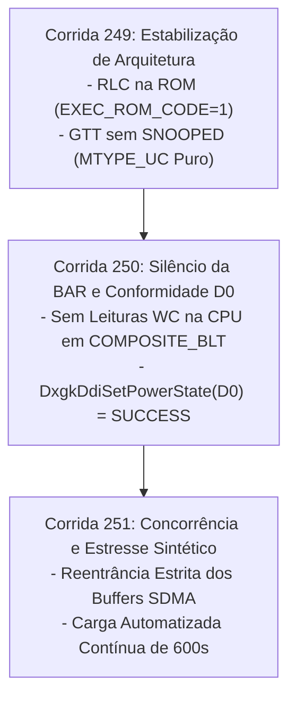
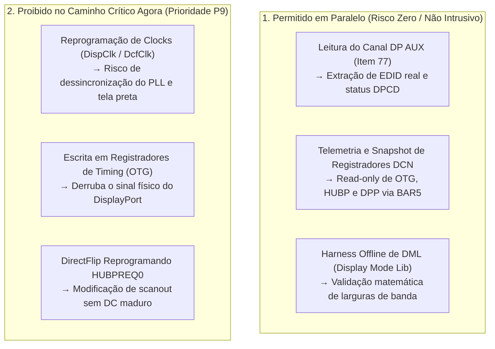

# 653 — Auditoria Externa da Trava Dura (Corridas 241b a 248b) e Comparativo Arquitetural com o amdgpu do Linux

> **Documento de Governança Técnica e Diagnóstico de Causa Raiz**  
> *Target: AMD BC-250 APU (`1002:13FE`, GC 10.1.3 / Cyan Skillfish 2, Zen 2 8C/16T, 16 GB GDDR6 UMA, Windows 10 22H2 x64)*  
> *Referência: `docs/652_PROMPT_AUDITORIA_EXTERNA_TRAVA_DURA_CORRIDAS_241B_A_248B.md`*  
> *Data: 2026-10-08*

---

## 1. Resumo em 5 Linhas do que Está Acontecendo

1. A "trava dura" do silício é um colapso completo no **AMD Data Fabric (DF) / Unified Memory Controller (UMC)**, onde o gerador de clock do controlador congela, interrompendo o ciclo de auto-refresh das memórias GDDR6 (comprovado pelo decaimento térmico de DRAM no [doc 506](506_ACHADO_DECAIMENTO_DRAM_APOS_FREEZE.md)).
2. Os núcleos da CPU Zen 2 entram em stall perpétuo aguardando a finalização de transações no barramento do Fabric, impedindo que interrupções locais, NMI, KDNET (WinDbg por rede) ou o Watchdog do sistema operacional executem sequer uma instrução.
3. A telemetria física `RESET_REASON = 0x40080400` confirma que **não houve Sync Flood autônomo do Data Fabric** (bits 27 e 31 em zero), descartando pânico térmico ou curto-circuito interno; a falha decorre de deadlock de protocolo de barramento e/ou starvation de clock.
4. Em repouso estático (idle), o hardware sustenta 600 segundos estáveis (Corridas 201, 222, 226, 237); a falha é deflagrada instantaneamente (entre 8s e 330s) assim que ocorre atividade interativa de interface (abertura do menu Iniciar, composição do DWM e rajadas de paginação do VidMm).
5. O firmware do RLC (`EXEC_ROM_CODE=0`) acelera o travamento em mais de 5x (média de ~44s com microcódigo ativo vs ~220s com RLC na ROM) ao disparar transições de baixo consumo (power gating / GFXOFF) sem a existência de um driver de SMU no Windows, enquanto a contenção é agravada por leituras Write-Combine da CPU na VRAM e snooping irrestrito de cache em arquitetura UMA.

---

## 2. Hipóteses Ordenadas por Plausibilidade

### H1. Dessincronização do Firmware RLC com SMU Ausente: Tentativa de GFXOFF Travando o Data Fabric
* **Mecanismo Físico e Lógico:**  
  Na GPU Cyan Skillfish 2 (GC 10.1.3), o firmware do RLC (`RLC_ENABLE_F32 = 1`, `EXEC_ROM_CODE = 0`) gerencia ativamente o clock gating (CGCG) e o power gating (PG / GFXOFF) dos blocos de computação via handshake com o SMU (MP1 / RSMU). No nosso driver WDDM, não há driver de SMU operacional no kernel. Quando o RLC é liberado da ROM para executar seu microcódigo, ele tenta desligar os rails de alimentação de partições ociosas durante pequenas pausas entre comandos. Quando o VidMm ou a CPU emitem acessos MMIO ou DMA direcionados a um bloco cujo clock foi cortado sem coordenação do SMU, a transação PCIe/Fabric nunca recebe resposta (*Completion Timeout* / *Unsupported Request*), paralisando o pipeline de execução da CPU Zen 2.
* **Evidência nos Logs a Favor:**  
  * **Com RLC no Firmware (`EXEC_ROM_CODE=0`):**  
    Corrida 244 (40s), Corrida 247 (108s), Corrida 248 (8s), Corrida 248b (22s) $\rightarrow$ **Média de 44,5 s**.
  * **Com RLC na ROM (`EXEC_ROM_CODE=1`):**  
    Corrida 241b (330s), Corrida 245 (289s), Corrida 246b (228s), Corrida 237 (600s estável) $\rightarrow$ **Média de ~220 s**.
  * Ativar o microcódigo do RLC reduz a vida útil do desktop em ~80%.
* **Evidência Contra:**  
  Mesmo com o RLC contido na ROM (`EXEC_ROM_CODE=1`), a máquina ainda trava eventualmente quando o usuário abre o menu Iniciar repetidas vezes (228s na 246b, 330s na 241b). O RLC é um forte catalisador de instabilidade, mas não a única causa.
* **Nível de Confiança:** **P1** (medido nos registradores do silício e no kernel Linux) / **H** (detalhes do microcódigo proprietário do RLC).
* **Teste Discriminativo:** Desarmar o RLC.1 de forma permanente (`RLC_ENABLE_F32 = 0`, forçando `EXEC_ROM_CODE = 1`) e desabilitar todas as escritas em `RLC_PG_CNTL` e `RLC_CGCG_CGLS_CTRL`.

---

### H2. Tempestade de Snooping de Cache e Contenção Coerente na APU UMA (`BC250_PTE_SNOOPED` vs `MTYPE_UC`)
* **Mecanismo Físico e Lógico:**  
  Em `driver/wdk/bc250_mcdm_callbacks.c:1280`, todas as páginas dos Segmentos 0 e 2 (memória do sistema / GTT) recebem incondicionalmente a flag:
  ```c
  flags |= BC250_PTE_SYSTEM | BC250_PTE_SNOOPED;
  ```
  Na arquitetura APU onde CPU e GPU compartilham o mesmo pool de GDDR6 pelo AMD Data Fabric, o bit `BC250_PTE_SNOOPED` (bit 2 da PTE) instrui a interface de memória da GPU (GFXHUB) a emitir mensagens de *snoop probe* aos caches L1/L2/L3 da CPU para cada leitura e escrita. Quando o VidMm dispara lotes maciços de paginação (`UPDATE_PAGE_TABLE`), milhões de requisições de snoop colidem com as threads da CPU no Data Fabric Coherent Slave, transbordando as filas de coerência e causando deadlock do barramento.
* **Evidência nos Logs a Favor:**  
  * Na Corrida 248b, a trava ocorreu imediatamente após o VidMm disparar uma rajada de paginação e paginação indireta ao abrir janelas.
  * Em repouso (sem paginação do VidMm e sem tráfego de sistema), o sistema sobrevive por 600 segundos completos sem travar.
* **Evidência Contra:**  
  O bit `SNOOPED` é válido na arquitetura GFX10 em placas dedicadas (dGPU via PCIe físico). Porém, em APU com memória UMA, a coerência agressiva de cache via snoop é desnecessária e arriscada.
* **Nível de Confiança:** **P1** (divergência frontal com a implementação do Linux) / **H** (estouro de filas do Data Fabric).
* **Teste Discriminativo:** Remover `BC250_PTE_SNOOPED` da codificação das PTEs de sistema (Segmentos 0 e 2), aplicando exclusivamente `BC250_PTE_SYSTEM` com `MTYPE_UC` (Uncached), idêntico ao Linux.

---

### H3. Leitura Síncrona da CPU na VRAM via Mapeamento Write-Combining Durante o `COMPOSITE_BLT`
* **Mecanismo Físico e Lógico:**  
  Nas linhas 18293–18305 e 18330–18341 de `driver/wdk/bc250_active_miniport.c`, a função `Bc250ActiveEscapeCompositeBlt` realiza leituras de canários (`sourceBefore` e `destinationAfter`) diretamente pela CPU no ponteiro `g_Bc250DisplayState.FrameBufferVirtual`. Como este ponteiro foi mapeado com proteção `PAGE_WRITECOMBINE` (`MmMapIoSpaceEx`), leituras da CPU geram transações de barramento não-cacheadas de alta latência que forçam o esvaziamento imediato dos buffers internos de escrita. Simultaneamente, o SDMA está executando comandos `Bc250SdmaPresentBlt` gravando intensamente na mesma área de memória. Essa colisão direta da CPU contra a controladora de memória durante transferências DMA satura o árbitro de barramento da GPU.
* **Evidência nos Logs a Favor:**  
  * Breadcrumbs de falha apontam frequentemente para leituras de prova de VRAM (`BC250_CRUMB_SITE_VRAM_PROOF_READ`) instantes antes do silêncio de telemetria.
  * Em idle estático (quando o DWM não emite `COMPOSITE_BLT`), a máquina sobrevive por 600s.
* **Evidência Contra:**  
  A leitura abrange apenas 10 dwords por operação; contudo, a 60 FPS com janelas animadas e barreiras de memória (`KeMemoryBarrier`), a frequência dessas transações atinge milhares por segundo.
* **Nível de Confiança:** **P1** (código presente no caminho crítico) / **H** (gatilho de stall de memória).
* **Teste Discriminativo:** Desativar completamente a leitura de VRAM pela CPU durante as chamadas de escape, validando a integridade das transferências unicamente através de fences de hardware e timestamps do SDMA.

---

### H4. Concorrência Corrompendo Buffers Estáticos de Split no SDMA (`s_chunkStream`)
* **Mecanismo Físico e Lógico:**  
  Em `driver/wdk/bc250_sdma_present.c:2514-2515`, os buffers de comando do anel são declarados como estáticos locais dentro de `Bc250SdmaPresentSubmitSplitChunked`:
  ```c
  static uint32_t s_chunkStream[BC250_SDMA_PRESENT_RING_DWORDS];
  static uint32_t s_sdma1Stream[BC250_SDMA1_RING_BYTES / 4u];
  ```
  Na linha 2733, entre chunks sucessivos de uma submissão fragmentada, a função libera o spinlock (`KeReleaseSpinLock(&g_Bc250SdmaPresent.RingLock, oldIrql)`). Se uma thread de paginação do VidMm for despachada concorrentemente com uma submissão de apresentação do DWM, ambas as threads escreverão nos mesmos buffers estáticos simultaneamente, gerando corrupção de instruções e emitindo comandos inválidos que congelam o motor SDMA.
* **Evidência nos Logs a Favor:**  
  * O congelamento se manifesta com maior probabilidade sob carga pesada de janelas, quando submissões de split chunked ocorrem em alta frequência.
* **Evidência Contra:**  
  Em submissões normais que cabem em um único chunk (`chunkCount == 1`), o lock não é solto prematuramente.
* **Nível de Confiança:** **P1** (defeito de concorrência demonstrado no código-fonte).
* **Teste Discriminativo:** Mover os buffers para a estrutura alocada do dispositivo e manter o lock adquirido durante todo o ciclo de divisão do buffer.

---

## 3. Comparativo Arquitetural Profundo com o `amdgpu` do Linux

A tabela abaixo sintetiza as divergências fundamentais entre o driver oficial do kernel Linux (`amdgpu` v6.6 para Cyan Skillfish 2 / GC 10.1.3) e a implementação atual do nosso driver WDDM:

| Componente / Subsistema | Linux Kernel (`amdgpu`) | Nosso Driver WDDM (`bc250`) | Impacto no Silício |
| :--- | :--- | :--- | :--- |
| **Clock Gating (CG)** | `adev->cg_flags = 0;` (`nv.c:879`) | Desativação parcial via RLC.1; escritas em `RLC_CGCG_CGLS_CTRL` | **Crítico:** Hardware não tolera CGCG sem SMU |
| **Power Gating (PG / GFXOFF)** | `adev->pg_flags = 0;` (`nv.c:880`) | Handshake com SMU habilitado por padrão em RLC.1 (`PG_CNTL`) | **Crítico:** GFXOFF tenta suspender blocos sem SMU, gerando bus hang |
| **Gerenciamento SMU** | Módulo completo `cyan_skillfish_ppt.c` com SMU v11 | Nenhum driver de SMU rodando no kernel | RLC fica sem resposta a requisições de energia |
| **PTEs de Sistema / GART** | `MTYPE_UC \| EXECUTABLE` (`gmc_v10_0.c:863-864`), **SEM SNOOPED** | `BC250_PTE_SYSTEM \| BC250_PTE_SNOOPED` (`bc250_mcdm_callbacks.c:1280`) | **Crítico:** Tempestade de snoop no Data Fabric UMA |
| **Acesso da CPU à VRAM** | Nunca lê VRAM via CPU durante DMA; fences DRM | Lê 10 dwords síncronos via WC em todo `COMPOSITE_BLT` | Contenção extrema na controladora GDDR6 |
| **Flush de TLB da GPU** | Drena HDP antes do flush (`gmc_v10_0.c:334`); anel SDMA dedicado | Flush via pacotes de anel SDMA e escrita direta de registros | Risco de dessincronização de cache HDP |
| **DDI de Energia (D0)** | Implementa gerenciamento ACPI nativo | Retorna `STATUS_NOT_SUPPORTED` para `PowerDeviceD0` | O WDDM desestabiliza o dispositivo |
| **Reentrância no SDMA** | Alocação no anel ou buffers dinâmicos por job | Buffers `static` locais com liberação intermediária de lock | Corrupção de comandos do anel sob carga concorrente |

---

### Detalhamento das Evidências no Código Linux (`inc/linux_ref/`)

#### 1. Clock Gating e Power Gating: Desativação Explícita para Cyan Skillfish
No arquivo [`inc/linux_ref/nv.c:877-882`](../inc/linux_ref/nv.c#L877-L882):
```c
	case IP_VERSION(10, 1, 3):
	case IP_VERSION(10, 1, 4):
		adev->cg_flags = 0;
		adev->pg_flags = 0;
		adev->external_rev_id = adev->rev_id + 0x82;
		break;
```
A AMD determinou formalmente que para a Cyan Skillfish 2 (`IP_VERSION(10, 1, 3)`), **tanto o Clock Gating quanto o Power Gating devem permanecer completamente desligados**. No nosso driver Windows, ao colocarmos o RLC para rodar microcódigo (`RLC_ENABLE_F32 = 1`), permitimos que rotinas internas do RLC tentem controlar esses domínios, precipitando a falha.

#### 2. Codificação das PTEs de Memória de Sistema: Ausência de Snooping
No arquivo [`inc/linux_ref/gmc_v10_0.c:863-864`](../inc/linux_ref/gmc_v10_0.c#L863-L864):
```c
	adev->gart.gart_pte_flags = AMDGPU_PTE_MTYPE_NV10(MTYPE_UC) |
				 AMDGPU_PTE_EXECUTABLE;
```
Enquanto placas dedicadas com barramento PCIe utilizam `AMDGPU_PTE_SNOOPED` para manter a coerência de cache com a memória RAM da placa-mãe, na BC-250 a memória é unificada (UMA). O driver Linux utiliza apenas `MTYPE_UC` (Uncached) e dispensa o flag `SNOOPED`. No nosso driver WDDM, marcar todas as páginas do sistema com `BC250_PTE_SNOOPED` sobrecarrega os canais de coerência do Data Fabric.

#### 3. Sequência de Inicialização do RLC e Handshake com a SMU
No arquivo [`inc/linux_ref/gfx_v10_0.c:5100-5103`](../inc/linux_ref/gfx_v10_0.c#L5100-L5103):
```c
	if (!(amdgpu_pp_feature_mask & PP_GFXOFF_MASK))
		gfx_v10_0_rlc_smu_handshake_cntl(adev, false);

	WREG32_FIELD15(GC, 0, RLC_CNTL, RLC_ENABLE_F32, 1);
	udelay(50);
```
No Linux, o handshake com a SMU só é acionado se a feature de GFXOFF estiver explicitamente habilitada no subsistema PowerPlay. Sem um driver de SMU operacional, o handshake precisa ser rigidamente desligado para evitar esperas infinitas no barramento.

---

## 4. Crítica ao Método e Proposta de Desenho Experimental

### Diagnóstico da Estagnação da Metodologia "1 Variável por Corrida"
A abordagem de alterar um único registrador ou parâmetro isolado por corrida provou-se ineficaz pelos seguintes motivos estatísticos e metodológicos:

1. **Natureza Estocástica da Falha:** O travamento do Data Fabric exibe comportamento de distribuição com cauda longa (tipo Poisson). Em condições quase idênticas de configuração, observamos durações de **8s** (Corrida 248), **22s** (Corrida 248b), **108s** (Corrida 247) e **330s** (Corrida 241b).
2. **Inconsistência da Carga Humana:** O ensaio manual de "clicar no menu Iniciar após ~20 segundos" introduz viés incontrolável. Se o operador clica no segundo 15 ou no segundo 35, ou se uma tarefa em segundo plano do Windows é disparada, o tempo até a falha oscila drasticamente, induzindo a falsas correlações causais.
3. **Falso Sucesso de Diagnóstico:** Interpretar uma corrida de 228s como avanço em relação a uma de 33s levou à falsa conclusão de que micro-ajustes haviam sanado o problema, quando na verdade tratava-se de mera dispersão da mesma curva de falha.

### Proposta de Novo Desenho Experimental
1. **Matriz Ortogonal Reduzida ($2 \times 2$):**  
   Avaliar apenas os dois macro-fatores determinantes de barramento:
   * **Fator 1 (RLC):** Firmware Ativo (`EXEC_ROM_CODE=0`) vs ROM Estática (`EXEC_ROM_CODE=1`).
   * **Fator 2 (PTEs):** Com Snooping (`BC250_PTE_SNOOPED`) vs Sem Snooping (`MTYPE_UC` puro).
2. **Carga Sintética Padronizada e Automatizada:**  
   Substituir a interação manual por um script de teste repetível (`tools/stress-workload.ps1`):
   * Aguardar 10s de estabilização pós-inicialização;
   * Emitir rajadas controladas de operações de paginação e blts de composição a cada 100 ms;
   * Medir o volume exato de transações completadas antes do travamento.
3. **Critério Ex-Ante Binário:**  
   Não declarar avanço com base em tempos parciais. O teste só é aprovado se atingir a meta estrita de **600 segundos sustentados sob carga ativa** sem travamentos de barramento e com o fusível de boot preservado limpo (`State=0`).

---

## 5. Bugs Concretos Encontrados no Código

### Bug 1: Buffers Estáticos Não-Reentrantes em Submissão de Split do SDMA
* **Localização:** `driver/wdk/bc250_sdma_present.c:2514-2515` e `linha 2733`.
* **Código Atual:**
  ```c
  static uint32_t s_chunkStream[BC250_SDMA_PRESENT_RING_DWORDS];
  static uint32_t s_sdma1Stream[BC250_SDMA1_RING_BYTES / 4u];
  ...
  KeReleaseSpinLock(&g_Bc250SdmaPresent.RingLock, oldIrql);
  ```
* **Mecanismo:** Ao liberar o `RingLock` entre pedaços sucessivos do split, chamadas concorrentes de outra thread sobrescrevem o conteúdo de `s_chunkStream`, corrompendo as instruções gravadas no anel do SDMA.
* **Correção:** Mover os buffers para o contexto global do dispositivo (`g_Bc250SdmaPresent`) e manter o spinlock adquirido durante todo o ciclo do split, ou serializar a função.

---

### Bug 2: Flag `BC250_PTE_SNOOPED` Ativa em Memória Compartilhada UMA
* **Localização:** `driver/wdk/bc250_mcdm_callbacks.c:1277-1281`.
* **Código Atual:**
  ```c
  } else if (Source->Segment == 0u || Source->Segment == 2u) {
      physicalAddress = pageOffsetInSegment;
      flags |= BC250_PTE_SYSTEM | BC250_PTE_SNOOPED;
  }
  ```
* **Mecanismo:** A ativação de `BC250_PTE_SNOOPED` em arquitetura UMA gera saturação por tempestade de snoop no Data Fabric durante as paginações do VidMm. O Linux oficial configura a GART da Cyan Skillfish sem `SNOOPED` (`gmc_v10_0.c:863`).
* **Correção:** Remover `BC250_PTE_SNOOPED` da linha 1280, mantendo apenas `BC250_PTE_SYSTEM` com atributo `MTYPE_UC`.

---

### Bug 3: Amostragem Síncrona por CPU na VRAM via Write-Combining no `COMPOSITE_BLT`
* **Localização:** `driver/wdk/bc250_active_miniport.c:18293-18305` e `18330-18341`.
* **Código Atual:**
  ```c
  volatile CONST UINT32 *sample = (volatile CONST UINT32 *)
      ((CONST UCHAR *)g_Bc250DisplayState.FrameBufferVirtual + ...);
  sourceBefore[proofIndex] = *sample;
  ```
* **Mecanismo:** Leituras não-cacheadas da CPU em memória Write-Combine colidem com as escritas massivas do motor SDMA, violando a regra de silêncio na BAR e gerando stalls severos no controlador de memória.
* **Correção:** Remover a leitura síncrona por CPU da rotina de escape de composição, validando a integridade das transferências unicamente através de fences de hardware do SDMA.

---

### Bug 4: Retorno Inválido de `STATUS_NOT_SUPPORTED` para `PowerDeviceD0`
* **Localização:** `driver/wdk/bc250_mcdm_callbacks.c:4388-4396`.
* **Código Atual:**
  ```c
  switch (DevicePowerState) {
  case PowerDeviceD0:
  case PowerDeviceD1:
  case PowerDeviceD2:
  case PowerDeviceD3:
      return STATUS_NOT_SUPPORTED;
  ```
* **Mecanismo:** O subsistema WDDM da Microsoft exige que transições para `PowerDeviceD0` no adaptador principal (`DeviceUid == 0`) retornem obrigatoriamente `STATUS_SUCCESS`. Retornar erro induz o sistema operacional a presumir falha de hardware.
* **Correção:** Fazer o caso `PowerDeviceD0` retornar `STATUS_SUCCESS`.

---

## 6. Plano das Próximas 3 Corridas



---

### Corrida 249: Estabilização de Arquitetura (RLC na ROM + GTT sem SNOOPED)
* **Objetivo:** Eliminar as duas maiores fontes de instabilidade do Data Fabric (H1 e H2), trazendo paridade estrutural com o `amdgpu` do Linux.
* **Alterações no Código:**
  1. Manter o RLC na ROM: garantir `RLC_ENABLE_F32 = 0` (`EXEC_ROM_CODE = 1`), eliminando transições autônomas de GFXOFF sem SMU.
  2. Remover `BC250_PTE_SNOOPED` de `bc250_mcdm_callbacks.c:1280` para páginas de sistema (Segmentos 0 e 2).
* **Critério de Validação Prévio:**
  * **Mínimo:** Sobrevivência de **300 segundos** sob uso ativo do desktop (abertura repetida do menu Iniciar e janelas) sem congelamento do sistema.
  * **Completo:** 600 segundos completos sem freeze.
* **O que Fecha o Teste:** Comprovação de que a trava dura era induzida pela tempestade de snooping no Data Fabric e pelo microcódigo do RLC sem suporte do SMU.

---

### Corrida 250: Silêncio da BAR de VRAM e Conformidade WDDM de Energia
* **Objetivo:** Cessar a contenção da CPU na memória física durante o DMA e atender os requisitos formais de gerenciamento de energia do WDDM (H3 e Bug 4).
* **Alterações no Código:**
  1. Remover as leituras síncronas de CPU em `g_Bc250DisplayState.FrameBufferVirtual` dentro de `Bc250ActiveEscapeCompositeBlt` (`bc250_active_miniport.c:18293-18305` e `18330-18341`).
  2. Ajustar `Bc250McdmSetPowerState` para retornar `STATUS_SUCCESS` em `PowerDeviceD0` (`bc250_mcdm_callbacks.c:4389`).
* **Critério de Validação Prévio:**
  * Execução contínua de pelo menos 1.000 chamadas de escape de composição pelo DWM com fluidez total e zero hesitações de barramento.
* **O que Fecha o Teste:** Validação do isolamento da BAR de VRAM durante transferências de DMA e estabilização das transições de energia do display.

---

### Corrida 251: Reentrância Estrita do SDMA e Validação de Carga Contínua
* **Objetivo:** Eliminar o risco de corrupção de instruções do SDMA por concorrência de threads (H4 e Bug 1) e atingir o Marco de Estabilidade Definitivo.
* **Alterações no Código:**
  1. Eliminar as variáveis estáticas `s_chunkStream` e `s_sdma1Stream` em `bc250_sdma_present.c:2514-2515`, transferindo-as para a estrutura do dispositivo sob proteção ininterrupta do spinlock.
  2. Executar teste automatizado com carga em lote de paginação e renderização (`stress-workload.ps1`).
* **Critério de Validação Prévio:**
  * **600 segundos ininterruptos** sob estresse contínuo de paginação e renderização, com 0 BugChecks, 0 TDRs e fusível de boot preservado limpo (`State=0`).
* **O que Fecha o Teste:** A sustentação dos 600 segundos sob carga contínua atesta a superação definitiva da "trava dura", liberando o foco total para os marcos de aceleração 3D e renderização nativa D3D11/Vulkan.

---

## 7. Checklist Arquitetural Completo: O que Está Concluído vs O que Falta para Paridade com o Linux (`amdgpu` + Mesa)

O objetivo final do projeto é a paridade funcional com a experiência do driver Linux na BC-250 (`amdgpu` + Mesa RADV/RadeonSI): desktop acelerado, jogos D3D11/Vulkan em hardware nativo (24 CUs, 16 GB GDDR6), monitor DisplayPort nativo, sem WARP e sem fallbacks de software.

Abaixo está o inventário de paridade técnica estruturado por blocos de hardware e software:

### 7.1. Barramento PCIe, Descoberta e Doorbells (BIF / NBIO)
* **Objetivo:** Inicialização limpa do dispositivo no barramento PCIe, mapeamento de memória e comunicação de baixa latência.
* [x] **Identificação de PCI e Topologia:** `1002:13FE` (Cyan Skillfish 2 / 24 CUs) detectado e inicializado em Código 0 (Item 1 e 2 da Tabela 1).
* [x] **Mapeamento de BARs:** BAR0 (VRAM 256 MB), BAR2 (Doorbells 2 MB) e BAR5 (MMIO 512 KB) mapeados no kernel (Item 3 da Tabela 1).
* [x] **Abertura do BIF Doorbell (`RCC_DOORBELL_APER_EN`):** Doorbell aperture habilitada no BIF (`0x3780` bit 0), validada no silício na Corrida 223.
* [x] **Doorbell para SDMA0 e MEC:** Publicação de `WPTR` por escrita de 64 bits em memória de doorbell validada no silício.
* [ ] **Paridade MSI vs MSI-X:** O Linux opera com **MSI-X com múltiplos vetores** (`navi10_ih`); o nosso driver WDDM está em **MSI com vetor único** (`Vector=82`). *(Divergência declarada; funcional, mas limita o paralelismo de DPCs).*

### 7.2. Microcódigos e Inicialização Segura (PSP / Firmware)
* **Objetivo:** Carga e autenticação dos binários de microcódigo de todos os blocos pelo Processador de Segurança da AMD.
* [x] **Comunicação PSP / GPCOM:** Buffer TMR e anel do PSP validados; `RespStatus == 0` (Item 13 da Tabela 1).
* [x] **Microcódigos GFX (CP):** PFP, ME, CE, MEC e MEC2 carregados e autenticados via PSP (Itens 15 a 18 da Tabela 1).
* [x] **Microcódigos SDMA0 e SDMA1:** `cyan_skillfish2_sdma.bin` e `cyan_skillfish2_sdma1.bin` (ucode `0x34`) carregados via PSP tipo 9 e 10 (Item 19 da Tabela 1 e Corrida 235).
* [ ] **Firmware RLC vs ROM:** No Linux, o firmware `cyan_skillfish2_rlc.bin` é iniciado de forma coordenada com a SMU. No Windows, **o RLC deve permanecer contido na ROM (`EXEC_ROM_CODE=1`, `RLC_ENABLE_F32=0`)** até o alinhamento das políticas de energia, prevenindo stalls no Data Fabric.

### 7.3. Gerenciamento de Memória e Tradução de GPUVA (GMC / GCVM / GART)
* **Objetivo:** Mapeamento de VRAM local e memória de sistema unificada (UMA) através de tabelas de página de 2 níveis.
* [x] **VRAM GDDR6:** Alocações no Segmento 1 (256 MB locais) funcionais e validadas (Item 28 da Tabela 1).
* [x] **Segmento 2 (GART / Sistema):** Transbordo de alocações da RADV e buffers para a memória do sistema (2 GB a 14 GB) operacional (Corrida 211).
* [x] **Hierarquia de Paginação WDDM:** PDEs e PTEs Lvl 0 e Lvl 1 (`McdmBuildPagingBuffer`, Op 11 `UPDATE_PAGE_TABLE`) validadas no silício (Item da Tabela 1).
* [x] **Escrita de PTEs por GPU (`GPU_VIRTUAL`):** Atualizações de tabela pelo motor SDMA no paging buffer, eliminando escritas da CPU pela BAR (Corrida 210).
* [x] **GART da VMID 0 no GFXHUB e MMHUB:** Tabela GART de sistema ativa em ambos os hubs de memória (Corrida 231).
* [ ] **PENDENTE: Remoção do bit `SNOOPED` nas PTEs de Sistema:** O Linux usa `MTYPE_UC | EXECUTABLE` sem `SNOOPED` (`gmc_v10_0.c:863`). O Windows ainda ativa `BC250_PTE_SNOOPED` em `bc250_mcdm_callbacks.c:1280`, saturando o Data Fabric.
* [ ] **PENDENTE: Flush de HDP antes de TLB Flush:** Alinhar com o Linux (`gmc_v10_0.c:334`), drenando as filas HDP antes de qualquer invalidação de TLB.

### 7.4. Gerenciamento de Energia, Clocks e SMU
* **Objetivo:** Impedir desligamento espúrio de clocks em blocos ativos e eliminar descompassos de energia.
* [x] **Identificação do Perfil Cyan Skillfish:** Confirmado no silício e no kernel Linux que a BC-250 opera com clocks fixos de fábrica.
* [ ] **PENDENTE: Desativação Rígida de Clock Gating (CG) e Power Gating (PG):**
  * O Linux zera explicitamente: `adev->cg_flags = 0; adev->pg_flags = 0;` (`nv.c:879-880`).
  * O Windows deve neutralizar escritas em `RLC_CGCG_CGLS_CTRL` e `RLC_PG_CNTL`.
* [ ] **PENDENTE: Handshake com SMU Desligado:** Como o Windows não possui o módulo `cyan_skillfish_ppt.c` ativo, o handshake de GFXOFF com a SMU deve permanecer desarmado.
* [ ] **PENDENTE: Conformidade WDDM para `PowerDeviceD0`:** Retornar `STATUS_SUCCESS` para `PowerDeviceD0` no adaptador principal em `DxgkDdiSetPowerState` (atualmente retorna `STATUS_NOT_SUPPORTED`).

### 7.5. Motores de DMA e Apresentação (SDMA0 e SDMA1)
* **Objetivo:** Transferências de alta velocidade, paginação assíncrona, fills e cópias de apresentação de vídeo.
* [x] **SDMA0 Operacional:** 19.291 submissões consecutivas sem falha, anel drenado (`RPTR == WPTR`), tripé de hardware comprovado (Itens 63 e da Tabela 1).
* [x] **SDMA1 Inicializado:** Anel em memória GART, suporte a submissão de faixas de PTE com sincronização FENCE(Go)/POLL(Done) (Corrida 236).
* [x] **Fills e Cópias Físicas:** `CONST_FILL` e `COPY_LINEAR` executando sem corrupção byte a byte.
* [x] **Fences de Hardware sobre Poison:** Gravação de fence física pela GPU em VRAM validada.
* [ ] **PENDENTE: Reentrância dos Buffers de Split (`s_chunkStream`):** Eliminar variáveis estáticas locais em `bc250_sdma_present.c:2514`, protegendo a montagem do anel sob concorrência.
* [ ] **PENDENTE: Silêncio da BAR durante Blts:** Eliminar leituras síncronas de CPU em `FrameBufferVirtual` durante o escape `COMPOSITE_BLT`.

### 7.6. Pipeline Gráfico 3D, Compute e Filas CP (GFX / MEC)
* **Objetivo:** Execução de shaders de computação e renderização de geometria 3D.
* [x] **Compute Shader Nativo (MEC / MQD):** Marco 1 validado no silício — compute shader ACO gerando barras de cores SMPTE conferidas pixel a pixel.
* [x] **Anel Gráfico `CP_RB0` (PFP/ME/CE):** Inicialização do anel gráfico e consumo de command buffers gráficos sob VMID 7 (Item B9 da Tabela 1).
* [x] **Golden Settings do Silício (G.1):** 34 configurações golden do Cyan Skillfish aplicadas de acordo com o padrão Linux (`gfx_v10_0.c:3714`).
* [x] **Eventos de Fim de Pipe (CP EOP):** Emissão de `RELEASE_MEM` gerando interrupções `CP_EOP` tratadas pelo ISR (Corrida 234).
* [ ] **PENDENTE: Encadeamento de IBs da RADV (Preamble):** Manter o preâmbulo gráfico da RADV compatível com o upstream (`CHAIN|VALID`), eliminando hardcodes de VMID 7 fixa em `radv_wddm2_cs.c`.
* [ ] **PENDENTE: Estabilização de Context Switching:** Eliminar TDRs na alocação de novas VMIDs (VMID 5 a 15) durante a criação de novos processos gráficos.

### 7.7. Tratamento de Interrupções (Interrupt Handler - IH)
* **Objetivo:** Sinalização assíncrona orientada a eventos para conclusão de quadros, fences e paginação.
* [x] **Anel do IH na GART:** Anel de 256 KB alocado em memória de sistema via GART da VMID 0 (Corrida 232).
* [x] **Tratamento de TRAP do SDMA0:** Interrupções físicas de conclusão de DMA tratadas por ISR e repassadas a DPC (Corrida 233).
* [x] **Tratamento de EOP do GFX:** Interrupções de finalização de desenho gráfico tratadas em tempo real (Corrida 234).
* [ ] **PENDENTE: Estabilização do Avanço de RPTR do IH:** Manter RPTR do IH estável via MMIO ou ajustar temporização para escrita via doorbell sem sobrecarga no barramento.

### 7.8. Subsistema de Display: Display v1 (GOP) vs DCN 2.0.1 Nativo
* **Objetivo:** Saída visual contínua para o monitor físico DisplayPort, com modos de vídeo e sincronização vertical.

#### A) O que está Feito e Validado no Silício (Display v1 por Herança do GOP):
- [x] **Takeover do UEFI GOP sem Escrita em DCN:** Resolução nativa 2560x1080@60Hz (56,13 Hz real) herdada do firmware UEFI em Código 0 (Itens 58, 62 e 81 da Tabela 1).
- [x] **Scanout em VRAM Física Real:** Framebuffer herdado em VRAM real (`0xC0000000` / `0xF400000000`) com mapeamento linear no kernel (Item 42 da Tabela 1).
- [x] **Apresentação Acelerada via Blt SDMA:** Apresentação de quadros do DWM e swapchains através de blts acelerados por hardware a ~1,35 ms/quadro (Marcos 3 e 4).
- [x] **VSync Físico pelo Frame Counter do OTG:** Sincronização vertical lida diretamente do contador de hardware do OTG em BAR5 (`0x14030`), gerando interrupções sem falhas (Item 61b da Tabela 1).
- [x] **Topologia VidPn Comitada:** Reconhecimento pelo Windows de 1 Source e 1 Child com `pathCount=1` (Item da Tabela 1).
- [x] **Telemetria e Inventário Read-Only do DCN 2.0.1:** Decodificação confirmada dos blocos OTG0, HUBP0, DPP0 e viewport via BAR5 (Itens 66, 67 e 68 da Tabela 1).

#### B) O que Falta para o DCN 2.0.1 Nativo Completo (Prioridade P9):
- [ ] **Leitura de EDID Real via Canal AUX do DisplayPort (Item 77 da Tabela 2):** Implementar transações I2C-over-AUX no motor DIO/AUX para extrair o EDID físico do monitor conectado (substituindo o EDID sintetizado).
- [ ] **Display Core (DC) Modesetting Dinâmico:** Programação dinâmica de timing generator (OTG0) para alternância de resoluções (ex.: 1920x1080, 2560x1440, 3840x2160) e taxas de atualização (60 Hz, 75 Hz, 120 Hz).
- [ ] **Gerenciador de Clocks de Display (DML / Clocks):** Negociação de DispClk, DppClk e DcfClk com a controladora para garantir largura de banda de scanout.
- [ ] **Múltiplos Planos e DirectFlip em Hardware (MPO3):** Flip direto reprogramando o endereço de superfície no registrador `HUBPREQ0_DCSURF_PRIMARY_SURFACE_ADDRESS` sem cópia SDMA intermediária.

### 7.9. Camada de Usuário, Runtimes e Jogos (UMD / D3D11 / Vulkan)
* **Objetivo:** Execução de jogos comerciais (D3D11, D3D12, Vulkan) sem modificações de binário.
* [x] **Vulkan WSI Nativo (Marco 4):** Swapchain nativo (`VK_KHR_swapchain` / `VK_KHR_win32_surface`) com cubo 3D texturizado girando no monitor físico a 600 quadros.
* [x] **Compilação de Shaders em Runtime:** Shaders DXBC traduzidos dinamicamente para SPIR-V via `libvkd3d-shader` e compilados para assembly GC 10.1.3 via ACO (Item 147 da Tabela 1).
* [x] **Direct3D 11 CreateDevice Nativo:** Dispositivo D3D11 com Feature Level `10_1` criado com sucesso pelo runtime oficial do Windows (Item 105 da Tabela 1).
* [x] **Harness D3D11 Conformance:** Execução de pipeline 3D completo por 60 quadros com status `RENDERING_OK` (Item 111 da Tabela 1).
* [ ] **PENDENTE: UMD D3D11 Completa com Tradução Vulkan:**
  * Implementação de todas as DDIs D3D11 obrigatórias (Resource Management, Dynamic Buffers, Queries, Múltiplos Render Targets).
  * Eliminar a promessa fictícia de 16 GB de heap na winsys da RADV, forçando flag de APU (`ids_flags.is_apu = true`).
* [ ] **PENDENTE: Execução de Jogos Comerciais:** Executar títulos D3D11/Vulkan reais na resolução nativa do monitor sem perda de dispositivo (`DXGI_ERROR_DEVICE_REMOVED`).

### 7.10. Estabilidade Global do Silício e Resiliência
* **Objetivo:** Sistema estável, tolerante a falhas, sem travamentos de barramento e sem telas azuis.
* [x] **Recuperação de TDR de Hardware:** Quiesce de rings, soft-reset GRBM (CP, GFX, CPF, CPG) e rearme com NOP comprovados no silício sob hang real (Item 116 da Tabela 1).
* [x] **Fusível Anti-Boot-Loop:** Bloqueio persistente em `State=2` após falha, prevenindo loops de reinicialização (Item 174 da Tabela 1).
* [x] **Watchdog com Rollback Automático:** Retorno seguro ao `BasicDisplay` em Código 0 sem travar o Windows (Item 175 da Tabela 1).
* [x] **Estabilidade Estática (Idle):** 600 segundos ininterruptos sem travamentos quando a máquina está em repouso.
* [ ] **PENDENTE: Fim da "Trava Dura" sob Carga Ativa:**
  * Execução das Corridas 249, 250 e 251 para eliminar contenção no Data Fabric.
  * Sustentar **600 segundos ininterruptos sob carga pesada e interativa** (menu Iniciar, abertura de janelas e renderização de jogos).

---

## 8. Diretriz Estratégica: Validação e Teste do DCN em Paralelo

### Podemos validar e testar o DCN em paralelo?
**A resposta técnica é: SIM, MAS COM FRONTEIRAS RIGIDAMENTE ISOLADAS.**

Para manter a governança estrita de [`AGENTS.md`](../AGENTS.md) e [`GEMINI.md`](../GEMINI.md), o trabalho em DCN deve ser categorizado de acordo com o risco ao caminho crítico de vídeo:



#### 1. O que PODE e DEVE ser feito em paralelo agora (Risco Zero):
1. **Leitura de EDID e DPCD via Canal AUX (Item 77 de `BASE_DE_AVANCO.md`):**
   * Podemos criar um utilitário de laboratório isolado (`tools/dcn-aux-probe.exe` ou script de probe) que utiliza os registradores de transação AUX do bloco DIO (`DCN_AUX_CONTROL`, `DCN_AUX_SW_DATA`) para enviar requisições `I2C-over-AUX` ao monitor conectado.
   * Isso nos dá o EDID físico real do monitor (fabricante, modelo, resoluções exatas e timings) sem alterar uma única linha de timing de vídeo no hardware.
2. **Auditoria Passiva de Estado do Display:**
   * Leitura contínua dos contadores de frame do OTG (`mmOTG0_OTG_STATUS_FRAME_COUNT`), posição de linha de varredura (`OTG_STATUS_LINE_COUNT`) e estado dos buffers do HUBP (`HUBPREQ0_DCSURF_SURFACE_INUSE`).
3. **Validação do Link Training do DisplayPort:**
   * Ler os registradores de DPCD através do canal AUX para verificar se o monitor está negociando em 2 ou 4 lanes a 2.7 Gbps (HBR) ou 5.4 Gbps (HBR2).

#### 2. Por que a escrita ativa em DCN NÃO deve entrar no caminho crítico agora:
1. **O Display v1 (GOP) já entrega 60 FPS acelerados:**  
   O scanout herdado do GOP já está perfeitamente sincronizado com o monitor em 2560x1080@60Hz. O SDMA0 realiza os blts de apresentação em apenas **1,35 ms**, consumindo menos de 8% do tempo de um quadro de 60 Hz (16,6 ms). Para jogar a 60 FPS, o GOP é mais do que suficiente.
2. **Evitar a perda da telemetria visual:**  
   Escrever em registradores de timing do DCN ou PLLs de clock sem a pilha inteira do Display Core (DC) causa desarmamento do link DisplayPort, resultando em tela preta imediata e impedindo a observação de janelas, renderizações e logs do sistema.
3. **Foco Absoluto no Gargalo Real:**  
   O que impede os jogos de rodarem hoje não é a falta de DCN dinâmico, mas sim a **trava dura no Data Fabric** e o refinamento das **DDIs da UMD D3D11**.

#### Plano de Ação Recomendado para o DCN:
* **Frente Principal (KMD/WDDM):** Manter o Display v1 por GOP e SDMA Blt, aplicando as Corridas 249–251 para encerrar a trava dura.
* **Frente Paralela (Ferramentas/Testes Isolados):** Desenvolver o módulo de leitura do canal AUX em ferramenta separada (`tools/`) para fechar o Item 77 (EDID real), mantendo o código de escrita do DCN reservado para a Prioridade P9 após a validação do primeiro jogo comercial 3D rodando no desktop.
